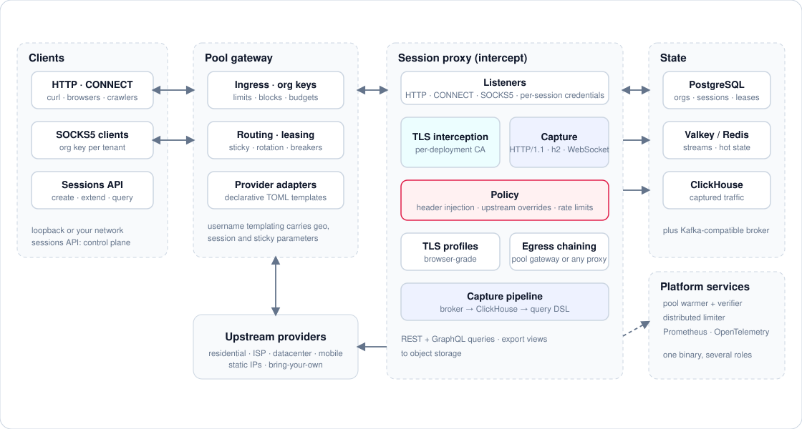
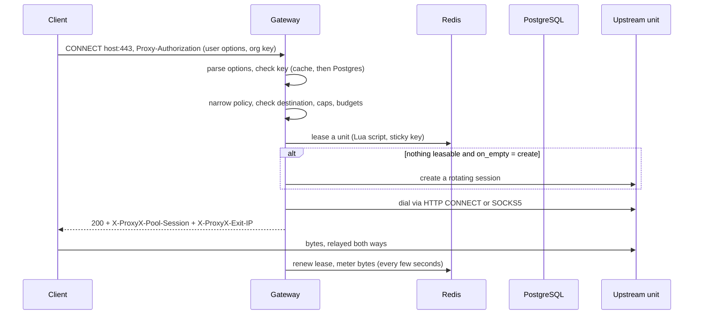
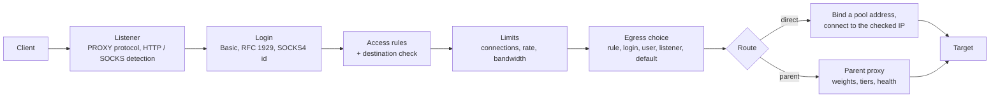

# Architecture

ProxyX is a Rust workspace that builds two binaries.

- `proxyx` runs one role per process: `gateway`, `warmer`, `control api`, `control ingester`, `limiter`, `edge`, and the `migrate`, `control keys` and `control schema` utilities.
- `proxyx-intercept` runs the session proxy. It is a separate binary because its upstream TLS stack (BoringSSL, chosen for browser-grade fingerprints) and the control plane's Kafka client (OpenSSL) export the same C symbols, so one process cannot hold both.



The picture shows three planes that share infrastructure but not code paths; the `edge` role (below) stands apart and needs none of it:

| Plane | Roles | What it does | State it owns |
|---|---|---|---|
| Pool | `gateway`, `warmer`, `migrate pool` | Authenticates clients by org key, leases upstream units, dials and relays tunnels, keeps pools healthy | PostgreSQL (source of truth), Redis (hot state) |
| Session | `proxyx-intercept`, `limiter` | Authenticates by session id, routes and optionally intercepts, rate-limits, publishes captures | Redis (sessions, rate-limit buckets, capture stream) |
| Control | `control api`, `control ingester`, `migrate control` | Creates sessions, API keys and orgs, ingests captures, answers queries and exports | PostgreSQL, a capture store (ClickHouse, or OpenSearch / Elasticsearch), Redis, object storage |

## Pool plane

### Process model

The gateway and the warmer are separate deployments of the same configuration.

- **Gateway.** One process serves the CONNECT, SOCKS5 and probe listeners, the `/v1` control API and the ops server. It copies the policy and inventory files under `data_dir` into Postgres, serves tunnels from a snapshot of policy, adapters and Postgres rows that it reloads every `reload_every`, and registers each tunnel so that the API can close tunnels (an org block, for example) on every replica.
- **Warmer.** Every replica runs every loop. A partition lock in Redis (`SET NX PX`, renewed) decides which replica works on which provider and region, so there is no leader election. The loops seed Redis from Postgres after a Redis loss, reconcile rotating partitions by creating sessions, send neutral keepalives, re-check and retest static IPs and apply the replacement rule, reset SIM boxes, sweep stuck state and refresh gauges. A failed canary pauses a route class until the API lifts the pause.
- **Ops server.** Each role starts its ops server first, so `/healthz` answers while dependencies are still connecting. `/readyz` answers `503 starting` until Postgres and Redis are connected and the first snapshot is loaded, and `503 draining` once the process is asked to stop. It stays up until every other task has ended, so the drain is scrapable.

### Request path



The password is the org key (`ak_...`), and the username carries options. [gateway.md](gateway.md) has the grammar, the order of checks and every refusal code. The gateway never falls back to a direct dial: when it cannot lease or dial a unit it refuses with a cause code.

### Providers, inventory and policies

- A **provider adapter** is a TOML template that renders a provider's username and password from the gateway's options (country, city, sticky id, lifetime). It is a pure function that refuses rather than escapes. See [providers.md](providers.md).
- **Units** are either rotating sessions that the warmer creates on a provider gateway, or static IPs, SIM boxes and customer upstreams from the inventory.
- A **policy** document decides regions, pool sizes, lease and rest times, block rules, spend and limits, layered global, route class, then org. An org value can never exceed a ceiling set in `limits`. See [policies.md](policies.md).
- Adapters, policies and inventory are files under `data_dir`. Postgres stays the source of truth: operator changes made through the API are kept until the file that defines the same policy changes.

### State

| Store | Holds | If it is lost |
|---|---|---|
| PostgreSQL | Org keys (SHA-256 only), policies, inventory, scores, org blocks, audit trail, customer upstreams | Gateways keep serving verified keys from a stale cache for a bounded time; new keys and policy changes fail. Restore from backup. |
| Redis / Valkey | Leases, ready sets, per-IP counters, cooldowns, breakers, sessions of open tunnels | Accepted and rebuilt: the warmer seeds Redis from Postgres. Leases restart and open tunnels continue until their next renewal. |

The gateway authenticates a key against an in-memory cache first. A key that Postgres has verified is trusted for a short window, a stale entry still answers while Postgres is down, and a key Postgres calls unknown is refused from memory for a few seconds. Failed lookups are counted per source (an IPv4 address or an IPv6 /64), so brute force costs the attacker, not the database. Exact windows are in [gateway.md](gateway.md#authentication).

### Verification

The warmer and the gateway check an exit IP before it serves traffic: several public services must agree on the address (and, for providers that report it, the country), and reputation scorers (IPQS, AbuseIPDB, Scamalytics) that you enable with API keys add a risk score. A static IP that keeps failing checks or collects block signals is quarantined and replaced under the policy's replacement rule. The optional Python [prober](../prober/README.md) measures candidates with a real browser through the probe listener, which opens only the hosts listed in `probe-targets.toml`.

## Session plane

`proxyx-intercept` is a data plane without a database. It reads sessions from Redis.

```mermaid
sequenceDiagram
    participant A as API client
    participant K as Control API
    participant R as Redis
    participant I as Session proxy
    participant T as Target
    participant B as Broker
    participant X as Ingester
    participant H as ClickHouse

    A->>K: POST /rpc/sessions (Bearer pxk_...)
    K->>R: SET session JSON with TTL
    K-->>A: session_id, proxy_url, ca_cert_pem
    A->>I: CONNECT host:443 (session id as username)
    I->>R: look up the session (cached)
    I->>T: dial (direct, or through an egress proxy)
    I-->>A: tunnel; TLS terminated with a CA-signed leaf when the host is captured
    I->>B: publish captured exchanges (protobuf)
    X->>B: consume, ack after insert
    X->>H: batched inserts
    A->>K: POST /rpc/requests/search
    K->>H: query
```

The session id is the only secret of a session proxy credential: the proxy accepts any password. A session decides which hosts are captured, which hosts are excluded, which headers are injected, which logical hosts are routed to private upstreams, which browser TLS profile is presented and what rate limit applies. An org's optional egress proxy (a second hop over SOCKS5 or HTTP CONNECT, for instance the pool gateway) is stored with the org and copied into the session at creation. Details are in [session-proxy.md](session-proxy.md).

Rate limiting runs in the proxy: a local token bucket per org refills from Redis (a Lua script) or from the `proxyx limiter` service. A Redis or limiter failure either denies requests or fails open for that org, by `failopen_policy`.

## Control plane

`proxyx control api` serves REST under `/rpc`, GraphQL under `/graphql`, health and metrics. It keeps session lifecycle rows and API keys in Postgres and queries captures in the capture store. `proxyx control ingester` consumes the capture log and writes the capture store in batches; it also marks sessions closed once their captures are flushed. The capture store is ClickHouse by default; `capture_store.backend = "opensearch"` selects OpenSearch or Elasticsearch 8 behind the same API (the sequence diagram above shows ClickHouse), see [capture-stores.md](capture-stores.md). Both are stateless, so run as many replicas as you need: ingester replicas share a consumer group. See [control-api.md](control-api.md) and [capture-pipeline.md](capture-pipeline.md).

Authentication is native: API keys (`pxk_...`) stored as SHA-256 in Postgres and managed with `proxyx control keys`, or, in `trusted_headers` mode, principal headers set by an authenticating gateway in front of the API.

## Edge proxy

`proxyx edge` is a self-contained forward proxy for one host that owns several IP addresses. It shares the destination denial and the dial primitives (`dial`) with the pool gateway but has no database, no Redis and no leases: its whole state is one TOML file, compiled into an immutable `State` (users, rules, pools, parents, limits, header policy, resolver) that SIGHUP swaps atomically while open tunnels keep the state they started with.



Each request goes through one pipeline (`crates/edge/src/conn.rs`) whatever its wire protocol: login, rules, the private-destination check on the name and on every resolved address, limits, egress choice and the connect, which binds a local address of the destination's IP family before `connect`. Forwarded HTTP opens one connection per request (so the egress address is chosen per request) and passes bodies through by their framing; `CONNECT`, SOCKS and upgraded connections become byte tunnels with bandwidth shaping and an idle timeout. The access log is written by its own thread through a bounded channel, so a slow disk drops lines (counted) and never slows a tunnel. See [edge-proxy.md](edge-proxy.md).

The pool gateway can lease the same host's addresses through a `scheme = "local"` adapter (a direct dial from a bound source address), see [providers.md](providers.md#local-units).

## Failure behavior at a glance

| Failure | Effect |
|---|---|
| Redis down (pool) | Leasing fails with `cache_unavailable`; `/readyz` turns 503 after three failed checks; the warmer rebuilds state from Postgres when Redis returns. |
| Postgres down (pool) | Verified keys keep authenticating from the cache for a bounded time; unknown keys get `cache_unavailable`; reloads keep the last good snapshot. |
| A provider fails | A per-route-class breaker opens after repeated failures and probes again with growing delays; tunnels charge it once per refused tunnel. |
| A bad reload (adapters, policies) | The last good configuration keeps serving and `config_reload_failed` is set. |
| Redis down (session proxy) | Sessions already cached keep working; unknown sessions answer `503` rather than `407`. |
| Broker or capture store slow | Capture buffers fill and apply backpressure to tunnels; captures are not dropped silently (`captures_dropped_total` counts the ones that fail after bounded retries). |
| Limiter down | By `failopen_policy`: deny, or fail open for the org. |
| A bad reload (edge) | The whole file is rejected, the running configuration keeps serving and `proxyx_edge_config_reloads_total{result="failed"}` counts it. |
| A local address stops working (edge) | Its circuit breaker opens after `failure_threshold` failed connects from it, or the active check finds it gone from the interface: it leaves the rotation and half-open probes bring it back. When every address of the family is out the answer is `503 egress_unavailable`, not a fallback to a shut-out address. |
| A parent proxy fails (edge) | Its breaker opens after `failure_threshold` failures, or its active probe fails; the next parent or tier (or direct, by route) serves meanwhile. `/readyz` turns `503` when no egress path is left. |

## Workspace layout

| Crate | Responsibility |
|---|---|
| `pool-common` | Shared vocabulary for the pool plane: types, cause codes, settings, metrics, probe tokens, telemetry |
| `policy` | Policy documents and the inbound username grammar |
| `provider` | Adapter TOML to upstream credentials, SIM box rotation client |
| `dial` | Upstream dialing (CONNECT, SOCKS5, or straight from a bound local address for `local` units), per-stage timing, destination denylist |
| `edge` | The self-hosted multi-IP forward proxy (`proxyx edge`): listeners, rules, egress pools, parents, limits, access log |
| `store` | Postgres access and migrations, Redis hot state with Lua scripts, snapshot loading and git-data sync |
| `verify` | Exit-IP quorum, reputation scorers, light probe, admission, replacement rule |
| `warmer` | The background loops |
| `gateway` | The data plane: listeners, authentication, leasing, relay |
| `pool-api` | The `/v1` control API and the ops server |
| `pool` | Wiring for `gateway`, `warmer` and `migrate pool` |
| `session-common` | Shared code of the session and control planes: sessions, broker abstraction, protobuf wire types, Redis connection, telemetry |
| `intercept` | The session proxy |
| `control`, `control-graphql`, `control-schema` | The control plane and its GraphQL schema |
| `limiter-proto`, `limiter-core`, `limiter-server`, `limiter-client`, `limiter-bench` | The rate-limit service, its protocol, client and benchmark |
| `proxyx` | The `proxyx` binary |

Crates that inherit the workspace lints forbid `unsafe` code and deny `clippy::unwrap_used`. The `limiter-core` and `limiter-server` crates do not inherit them: their lock-free token buckets and signal handling use `unsafe`, confined to those two crates. Release builds abort on panic, so the process manager must restart crashed processes, and clock arithmetic that could overflow is guarded.
