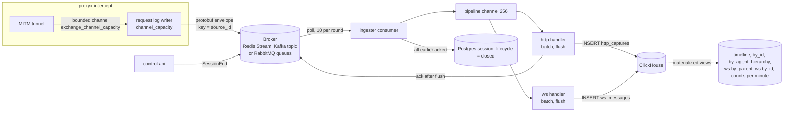

# Capture pipeline

Every HTTP exchange and WebSocket message that the [session proxy](session-proxy.md) intercepts travels through one pipeline to ClickHouse, where the [control API](control-api.md) queries it:



Delivery is at-least-once. Duplicates are possible and are handled only partly by ClickHouse itself; see [Duplicates and deduplication](#duplicates-and-deduplication) for exactly which ones.

This page describes the ClickHouse store, which is the default. The pipeline up to the batch handlers is the same for the OpenSearch / Elasticsearch store (`capture_store.backend = "opensearch"`), which has its own settings, schema and a duplicate-free write path: see [capture-stores.md](capture-stores.md).

## Envelope

Everything on the broker is a `RequestLogMessage` protobuf (`crates/session-common/proto/proxyx.proto`, package `proxyx`), a `oneof` of three kinds:

| Field | Number | Message | Producer |
|---|---|---|---|
| `request` | 1 | `CapturedRequest` | proxy |
| `session_end` | 2 | `SessionEndEvent` | control API |
| `ws_message` | 3 | `CapturedWsMessage` | proxy |

`CapturedRequest`:

| Field | Number | Notes |
|---|---|---|
| `event_id` | 1 | 16 raw bytes, UUIDv7 minted when the exchange finishes; the capture's identity (`id` in ClickHouse) |
| `session_id` | 2 | 16 raw bytes |
| `proxy_id` | 3 | the proxy's `id` |
| `org_id`, `source`, `source_id` | 4, 5, 6 | copied from the session |
| `timestamp_nanos` | 7 | wall clock when the proxy read the request line |
| (reserved) | 8 | |
| `method`, `scheme`, `host`, `port`, `path` | 9 to 13 | `scheme` is `http` or `https`; `path` has the scheme and authority removed |
| `request_headers` | 14 | repeated `Header { name, value }`, session credential headers removed, values cut at `max_header_capture` |
| `request_body`, `request_body_size`, `request_body_truncated` | 15 to 17 | body cut at `max_body_capture`; the size is the full wire size |
| `response_status` | 18 | |
| `response_headers`, `response_body`, `response_body_size`, `response_body_truncated` | 19 to 22 | |
| `duration_ms` | 23 | request start to response end |
| `ratelimit_wait_ms` | 24 | always 0 in the current proxy (the timing field is never filled) |

`CapturedWsMessage`: `event_id` (1), `parent_event_id` (2, the `event_id` of the `101` row), `session_id` (3), `proxy_id` (4), `org_id` (5), `source` (6), `source_id` (7), `timestamp_nanos` (8, set when the message is complete), `direction` (9: `WS_DIRECTION_C2S` = 1, `S2C` = 2), `opcode` (10: `TEXT` 1, `BINARY` 2, `CLOSE` 8, `PING` 9, `PONG` 10), `payload` (11, reassembled and decompressed, cut at the body cap), `payload_size` (12, size before the cut), `payload_truncated` (13), `was_compressed` (14), `close_code` (15), `close_reason` (16), `host` (17).

`SessionEndEvent`: `session_id` (1, raw bytes), `org_id` (2), `source` (3), `source_id` (4), `timestamp_nanos` (5). Published by the control API when a session's last reference is released, and by its reapers ([session lifecycle](control-api.md#session-lifecycle)).

Capture records are keyed by `source_id`; `SessionEnd` uses the same key. Messages with the same key are published in order; with Kafka they land on the same partition and with RabbitMQ in the same queue.

## Broker

`broker_kind` selects the transport. The proxy, the control API and the ingester must agree on it.

### Redis Streams (`redis_stream`, default)

- **Produce.** `XADD <stream> [MAXLEN ~ N] * data <payload>`. The stream name is `request_log.stream_name` on the proxy and `request_log_stream` on the control plane (default `proxyx:request_log` for both); `max_stream_len` / `request_log_max_stream_len` (default 1 000 000, 0 = no trimming) caps the length approximately. The stream is a single partition, so all messages are globally ordered and the key is ignored. The stream is not prefixed by `redis_key_prefix`.
- **Consume.** A consumer group (`consumer_group`, default `proxyx_control`) is created on first start with `XGROUP CREATE ... 0 MKSTREAM`, so a new group reads the stream from its beginning. Each ingester has a consumer name `ingester-<8 hex>`. Each poll first runs `XAUTOCLAIM` with a 30 s minimum idle time and returns what it reclaimed; only when nothing is pending does it block on `XREADGROUP ... BLOCK 5000 STREAMS <stream> >` on a dedicated connection. The consumer pulls 10 messages per poll.
- **Ack.** `XACK` after the batch containing the message was flushed to ClickHouse (below). An entry that cannot be parsed (no `data` field) is acked and dropped so it cannot be reclaimed forever.
- **`session_offset`.** The stream id `<ms>-<seq>` packed into a `u64` as `(ms << 20) | (seq & 0xFFFFF)`. It is monotonic across milliseconds. It is the broker position stored in the ClickHouse sort key.
- **Retention.** `MAXLEN ~` trims by length without regard to acknowledgement. If the ingester falls more than about `max_stream_len` messages behind, unread entries are lost.

### Apache Kafka and Kafka-compatible brokers (`kafka`)

`broker_kind = "kafka"` works with Apache Kafka (KRaft or ZooKeeper) and with Kafka-compatible brokers such as Redpanda: ProxyX speaks only the Kafka protocol. `broker_kind = "redpanda"` and the `[redpanda]` section (`PROXYX_*_REDPANDA__*`) are **deprecated aliases** of `kafka` and `[kafka]`, accepted for one more release; they log a warning at start. Setting both `[kafka]` and `[redpanda]` is an error.

```toml
broker_kind = "kafka"
[kafka]
brokers = "kafka-0:9092,kafka-1:9092,kafka-2:9092"
topic = "proxyx.captures"
partitions = 12            # default 12; permanent
replication_factor = 3     # default 3; use 1 on a single node
retention_ms = 604800000   # default 7 days; set when migrate creates the topic
client_id_prefix = "proxyx"
compression = "none"       # none (default), gzip, lz4, snappy or zstd
acks = "all"               # the only accepted value
linger_ms = 0              # coalesce concurrent publishers for up to this long
batch_bytes = 1048576      # largest produce request; keep it within the broker's message.max.bytes
[kafka.tls]                # optional
ca_cert = "/etc/proxyx/secrets/ca.pem"
client_cert = "/etc/proxyx/secrets/client.pem"
client_key = "/etc/proxyx/secrets/client.key"
[kafka.sasl]               # optional
mechanism = "SCRAM-SHA-512"   # PLAIN, SCRAM-SHA-256 or SCRAM-SHA-512
username = "proxyx"
password = "..."
```

- **Topic.** `proxyx migrate control` (or `--target broker`) creates the topic with the partition count, replication factor and `retention.ms` through librdkafka's admin client. It fails if the topic already exists with a different partition count, because the count cannot change. An existing topic is not altered: a different `retention.ms` is reported in a warning, change it with `kafka-configs.sh` or `rpk`. `--check` verifies that the topic exists with the configured partition count. Both the proxy and the control API fail at startup if the topic does not exist.
- **Produce.** The proxy and the control API use a pure-Rust Kafka client (rskafka, so it can live next to BoringSSL). A record goes to partition `FNV-1a(key) mod partitions`, where the key is the `source_id`, so one source's captures and its `SessionEnd` keep their order. Records go in produce requests of at most `batch_bytes` (1 MiB by default), compressed with `compression`; partitions are produced in parallel and, within a partition, requests go one after another and stop at the first failure. A record larger than `batch_bytes` fails alone (it is dropped after the retry budget). The producer always waits for all in-sync replicas (`acks = "all"`): the client has no weaker mode, and the durable-publish contract needs this one, so any other value is rejected at start.
- **Linger.** With `linger_ms > 0` the producer collects the records of calls that overlap in time, for up to `linger_ms` or until `batch_bytes` are waiting, and sends them as one request per partition, in arrival order; a failed request blocks the later records of its partition for every caller, as within one call. The control API publishes `SessionEnd` from concurrent request handlers and benefits; the session proxy's single writer already hands over everything it has queued in one call, so leave it at `0` there.
- **Consume.** The ingester uses a librdkafka consumer group (`consumer_group`) with `cooperative-sticky` assignment, `auto.offset.reset = earliest` (a new group starts from the beginning of the topic), `enable.auto.commit` every 5 s, and `enable.auto.offset.store = false`: an offset is stored for commit only when every earlier offset of that partition has been acked (a contiguous watermark). The security protocol follows the sections: `ssl` with `[kafka.tls]`, `sasl_plaintext` with `[kafka.sasl]` alone, `sasl_ssl` with both (the producer behaves the same; earlier releases always used `sasl_ssl` on the consumer when SASL was set).
- **Ack.** Kafka never redelivers an un-acked offset to the consumer that owns the partition, so every message must be acked; one missing ack holds that partition's commit until the partition moves to another consumer. Acks of a revoked partition are ignored. A malformed envelope is acked and skipped.
- **`session_offset`.** The partition offset.
- **Health.** The ingester's Kafka connection starts down and is up only after a message arrives or a metadata request succeeds, which needs a working TLS and SASL handshake, so `/health` is `503` at start and with a wrong CA, client certificate or credentials. It goes down again when librdkafka reports every broker unreachable. The producers report down after a failed produce request and up after a successful one.

### RabbitMQ (`rabbitmq`)

```toml
broker_kind = "rabbitmq"
[rabbitmq]
url = "amqps://rabbit.internal:5671/proxyx"   # amqp:// or amqps:// (vhost is the path)
username = "proxyx"                            # optional: override the credentials in the URL
password = "..."
exchange = "proxyx.captures"                   # direct exchange; default
partitions = 12                                # partition queues; permanent
quorum_group_size = 3                          # replicas per queue at declaration; 1 on a single node
delivery_limit = 20                            # redeliveries before a message is dead-lettered
message_ttl_ms = 604800000                     # 7 days; 0 keeps messages until consumed
prefetch = 500                                 # unacked messages per queue; keep >= the ingester's bulk_size
heartbeat_secs = 30
connect_timeout_secs = 10
confirm_timeout_secs = 30                      # wait for one chunk of publisher confirms
reconnect_initial_backoff_ms = 500
reconnect_max_backoff_ms = 30000
[rabbitmq.tls]                                 # for amqps://: CA and optional client certificate (PEM, PKCS#8 key)
ca_cert = "/etc/proxyx/secrets/rabbit-ca.pem"
client_cert = "/etc/proxyx/secrets/client.pem"
client_key = "/etc/proxyx/secrets/client.key"
```

TLS uses rustls. RabbitMQ 3.13 and 4.x are supported (tested on 4.x); the quorum queue features used (single active consumer, delivery limit, dead-lettering, message TTL) need 3.10 or later.

- **Topology.** `proxyx migrate control` (or `--target broker`) declares, all durable: a direct exchange `<exchange>`; `partitions` quorum queues `<exchange>.p00` ... bound with routing keys `p00` ...; a dead-letter exchange `<exchange>.dlx` and a quorum queue `<exchange>.dead` for poison messages. `--check` verifies that the queues exist. Re-running is idempotent; a queue that exists with different arguments (delivery limit, TTL, group size) makes the broker refuse the declaration, and the error says so: delete the queue once drained, or restore the old settings. The proxy, the API and the ingester fail at start when the queues are missing or the broker is unreachable.
- **Ordering.** A record goes to queue `FNV-1a(key) mod partitions` (the Kafka mapping), so every message of one `source_id`, its captures and its `SessionEnd`, sits in one queue. A queue delivers in publish order, and every partition queue has `x-single-active-consumer`: only one consumer at a time receives from it, so order holds across ingester replicas and restarts. The cost is that parallelism is per queue and balance between replicas is approximate: the broker makes the first consumer to register on a queue the active one, so each replica registers its queues in a random rotation, and a replica takes over the queues of one that went away. Redelivered messages (after a lost connection) are marked `redelivered` and come back in their original positions.

  Unlike Kafka and Redis Streams, RabbitMQ does not use `consumer_group` to create independent subscriptions: all ingesters on the same exchange share its partition queues. To feed independent stores, declare a separate exchange/topology for each deployment.
- **Why quorum queues, not streams.** RabbitMQ streams would give offsets, but the maintained Rust stream client has no consumer-side acknowledgement or group coordination, which the ack-after-flush contract and multi-replica ingesters need. Quorum queues give durability (Raft replication), publisher confirms, manual acks, a delivery limit and dead-lettering with the AMQP client `lapin`.
- **Produce.** One connection and one confirm-mode channel. A batch is split per partition and each partition's records are published in order, persistent and `mandatory`, in chunks of 256 whose publisher confirms are awaited before the next chunk. A nack, an unroutable return (queue missing), a confirm timeout (`confirm_timeout_secs`) or a channel error fails the record; the records after it in its partition are `NotSent`, so the proxy's retry keeps their order. (Inside one chunk, records after the failed one were already sent and count as published.) A lost connection is re-established on the next publish; failed connects back off exponentially from `reconnect_initial_backoff_ms` to `reconnect_max_backoff_ms`, and while backing off a publish fails at once, which the proxy's own retry budget absorbs like any broker failure.
- **Consume.** One connection and channel with `basic.qos(prefetch)` and one consumer per queue. A message is acked only after the ingester flushed its batch to the capture store (below), so a crash or lost connection leaves it unacked and RabbitMQ redelivers it. The prefetch bounds the unacked messages per queue; with a prefetch smaller than the ingester's `bulk_size` the buffer fills only to the prefetch and waits for the `flush_interval_secs` tick, so keep it at least `bulk_size`. After a lost connection, `poll` reconnects with the same backoff (empty polls while it waits), and acks of handles from the old connection fail and are logged: those messages were redelivered.
- **Poison messages.** An envelope that does not decode is rejected without requeue and lands in `<exchange>.dead` (the other brokers ack and skip it). A message redelivered more than `delivery_limit` times, for example one that crashes the consumer every time, is dead-lettered too, as is a message older than `message_ttl_ms`. Inspect and replay the dead-letter queue with the management UI or `rabbitmqadmin`; ProxyX never reads it.
- **`session_offset`.** RabbitMQ has no per-queue offsets, so the producer stamps each message with the header `px-seq` = `(unix_ms << 20) | counter`, strictly increasing within a producer process (the counter never falls below the clock), the same packing as a Redis stream id. The consumer uses it as `session_offset`. It is monotonic per key as long as one producer process publishes that key, which holds because a session's captures come from the one proxy that owns it; across processes it follows the wall clock. The key is stamped in the header `px-key`. Messages published by something else lack the headers and get their arrival time.
- **Health.** The ingester's `/health` is `503` while its connection is down, and the producers report down after a failed connect or confirm until a publish succeeds.

### Which broker

Redis Streams needs nothing but the Redis you already run for sessions, but it is a single partition with length-based trimming. Kafka scales out by partitions and keeps the backlog by time; pick it for volume. RabbitMQ fits sites that already operate it and want broker-side dead-lettering; its throughput per partition queue is bounded by one consumer. Redis stays in every deployment, for sessions, rate-limit buckets, the pool's hot state and block-signal and session-invalidation notifications, whichever broker carries the captures: those are small control messages on a store the control plane already needs, and a second transport for them would add moving parts without a benefit.

### Broker metrics

All three brokers report the same families (labelled `broker`): `proxyx_broker_publish_records_total{broker,outcome}`, `proxyx_broker_publish_duration_seconds{broker}`, `proxyx_broker_consumed_total{broker}`, `proxyx_broker_acks_total{broker,outcome}`, and, for Kafka and RabbitMQ, `proxyx_broker_connected{broker,role}` and `proxyx_broker_reconnects_total{broker,role}`. See [metrics/session-proxy.md](metrics/session-proxy.md).

## Proxy side: buffering and publishing

1. Each tunnel has a channel for exchanges and one for WebSocket messages, both of `tuning.exchange_channel_capacity` (default 8). A full channel blocks the tunnel, which delays the client; nothing is dropped here.
2. A per-tunnel task builds the capture (adds `scheme`, `port`, session metadata) and sends it into the process-wide writer queue of `request_log.channel_capacity` (default 256). HTTP captures and WebSocket messages share this one FIFO, so per-source order survives, and the `101` row is queued before the first message of its conversation.
3. One drain task takes everything queued (up to 256), encodes it and publishes it as a batch; the next batch starts only after this one is published. A batch the broker accepts increments `proxyx_intercept_captures_published_total`.
4. Failed records are retried in order with exponential backoff (50 ms, doubling to 5 s). A record is dropped after its fifth failed attempt (`proxyx_intercept_captures_dropped_total`, logged at `error`). That is a short budget: a record at the head of the batch is abandoned after about 0.75 s of backoff plus the attempt times, so a broker outage longer than a second or so drops captures at the rate the proxy produces them, while a blip is absorbed. Records behind a failed one are not charged attempts. A publish that runs longer than 5 s logs `capture batch publish stalled`.
5. A WebSocket message that cannot be encoded is dropped with a warning.

At shutdown the writer is closed and drained within 30 s ([graceful shutdown](session-proxy.md#graceful-shutdown)). Captures still queued or in a failing batch when the process is killed are lost.

Sessions whose lookup fails at intercept time (the session vanished between authentication and the first exchange) stop capturing: the exchanges are discarded and a warning is logged.

## Ingester

`proxyx control ingester` connects to the relational database (PostgreSQL, MariaDB or SQLite, to close sessions), builds the consumer for `broker_kind`, and runs:

1. **Consumer loop.** Polls 10 messages at a time. Every message gets a local sequence number. A message that does not decode is acked and counted as `proxyx_ingester_messages_total{outcome="error"}`; an envelope without a kind is acked and skipped. Captures and WebSocket messages are sent to the pipeline together with their ack handle and `session_offset`; they are not acked yet.
2. **Pipeline.** A channel of 256 messages feeds two independent handlers, one for `http_captures` and one for `ws_messages`, so a stall on chatty WebSocket inserts does not block HTTP captures and vice versa.
3. **Normalization.** The row is built as follows.
   - `timestamp` has millisecond precision (`DateTime64(3, 'UTC')`).
   - Bodies are decoded: `gzip`/`x-gzip`, `deflate` (standard zlib-wrapped and legacy raw streams) and `br` request and response bodies are decompressed (up to 16 MiB; beyond that, or on a decode error, the raw bytes are kept) and the `content-encoding` and `content-length` headers are removed when decoding succeeded. A truncated body in one of those encodings is stored empty, because a partial stream cannot be decoded; a truncated body with no encoding, `Content-Encoding: identity` or any other (unknown, unsupported or chained) encoding keeps its captured bytes and its headers unchanged, like a complete body in such an encoding.
   - Bodies are stored as `String`: a body that is not valid UTF-8 becomes the empty string, and NUL bytes are removed. Sizes (`request_size`, `response_size`) always carry the wire byte count. WebSocket payloads are stored byte for byte; `payload_is_text` records whether they were valid UTF-8, and NULs are stripped from text payloads.
   - Numeric fields are clamped to the column width (`u32`, `u16`).
4. **Correlation headers.** Four request headers are copied into dedicated nullable columns: the first header whose name matches case-insensitively, trimmed, empty values becoming `NULL`:

   | Column | Header (default) | Config key |
   |---|---|---|
   | `correlation_id` | `X-ProxyX-Agent` | `correlation_id_header` |
   | `parent_correlation_id` | `X-ProxyX-Parent-Agent` | `parent_correlation_id_header` |
   | `account_id` | `X-ProxyX-Account` | `account_id_header` |
   | `tool_call_id` | `X-ProxyX-Tool` | `tool_call_id_header` |

   The value is read from the capture's `request_headers`, which holds what the client sent (after the proxy removes `Proxy-Authorization` and `Proxy-Connection`, and truncates values to 512 bytes). Headers added by the session's `inject_headers` are not part of that list, so the client itself must send these headers for the columns to be filled. Setting a key to an empty string matches no header and leaves the column `NULL`. The headers stay in `request_headers` as well.
5. **Closing sessions.** See [below](#session-close).

### Batch flushing and backpressure

Each handler buffers rows and writes them with one `INSERT` per flush. Settings are in the `[clickhouse]` table (`PROXYX_CONTROL_CLICKHOUSE__<KEY>`):

| Key | Default | Meaning |
|---|---|---|
| `url` | required | ClickHouse HTTP endpoint |
| `database`, `user`, `password` | none | |
| `table` | `http_captures` | target of the HTTP handler; WebSocket rows always go to `ws_messages` |
| `bulk_size` | 500 | flush when the buffer holds this many rows; the intake channel holds `2 x bulk_size` |
| `flush_interval_secs` | 5 | flush a non-empty buffer at least this often |
| `max_buffer_bytes` | 268435456 (256 MiB) | soft cap on buffered payload bytes (estimated from body, header and payload sizes) |
| `circuit_breaker_threshold` | 5 | consecutive failed flushes before the circuit opens |
| `circuit_breaker_reset_secs` | 60 | how long the circuit stays open |

Behaviour:

- **Ack after durable write.** The ack of every message of a batch fires only after the `INSERT` succeeded, so an unflushed message is redelivered after a restart.
- **Failed insert.** The rows go back into the buffer (and are retried at the next flush) and their acks do not fire. Each failure counts toward the circuit breaker.
- **Circuit breaker.** After `circuit_breaker_threshold` consecutive failures the circuit opens for `circuit_breaker_reset_secs`: flushes are skipped, rows keep accumulating. When the time passes, the next flush is attempted without a probe phase; the failure counter is not reset until a flush succeeds, so one more failure re-opens the circuit immediately. `proxyx_ingester_circuit_open{table}` is 1 while open.
- **Backpressure.** When buffered bytes reach `max_buffer_bytes` the flusher stops taking rows from its channel (it retries the flush, sleeping 100 ms to 1 s between failures). The channel fills, the pipeline dispatcher blocks, and the consumer stops polling, so nothing is dropped: the backlog stays in the broker. With Redis Streams it remains subject to stream trimming; with Kafka it is bounded by `retention_ms` and with RabbitMQ by `message_ttl_ms` (expired messages are dead-lettered).
- **Poison rows.** A row that cannot be serialized into the insert is dropped, counted in `proxyx_ingester_rows_dropped_total{table}`, and its message is acked (otherwise Kafka would hold the partition's commit forever). The rest of the batch is inserted.
- **Lag.** `proxyx_capture_commit_lag_seconds{table}` observes the time from the end of the exchange (the WebSocket message time for `ws_messages`) to the successful insert; `proxyx_ingester_flush_duration_seconds` times each flush.
- **Shutdown.** On `SIGTERM` the consumer stops, the pipeline channel closes and the handlers flush what they hold, within a 30 s budget split between draining and flushing. Anything not flushed in time is read again after restart.

The ingester does not run ClickHouse or broker migrations when it starts; apply them with `proxyx migrate control --target clickhouse` ahead of time (`--check` verifies). With the OpenSearch store the ingester checks at start that its index templates exist and fails otherwise; install them with `proxyx migrate control --target opensearch`.

## Session close

A session ends when the control API publishes a `SessionEnd`. The row in Postgres `session_lifecycle` is `consuming` from then, and the ingester decides when it becomes `closed`:

- Every polled message gets a sequence number. A `SessionEnd` is registered with its sequence number and acked immediately (so an unreachable ClickHouse never leaves a `SessionEnd` unacked).
- A session is released when the `SessionEnd` **and every message this consumer read before it** have been acked, that is, stored in ClickHouse. The row then becomes `closed` (`UPDATE ... SET state = 'closed', closed_at = now()`), which is what `GET /rpc/sessions/{id}/status` and `GET /rpc/processed` report.
- If the update fails, the row stays `consuming`, and the control API's reaper re-sends the `SessionEnd` after 5 minutes.
- With `session_lifecycle_writes = false` the ingester releases sessions the same way but leaves the Postgres row alone; use this on an ingester that feeds a ClickHouse cluster that does not serve reads, so only the serving side closes sessions.

Two limits follow from this:

1. The guarantee covers messages *this consumer* read earlier. If several ingesters share a consumer group (several Redis consumers, or Kafka partitions assigned to different ingesters), captures held by another ingester are not tracked, and a session can close before they are stored.
2. A capture the proxy publishes after the control API published `SessionEnd` (for example a tunnel still draining when the session is deleted) can be stored after the session is `closed`; the proxy and the API publish independently.

## ClickHouse schema

Schema files are in `crates/control/clickhouse/`: `init.sql`, `ws_init.sql`, `indexes.sql`, `ws_indexes.sql`, then dated files in `migrations/`, applied in file-name order and recorded in `_ch_migrations`. Tables use `Replicated*` engines and a storage policy `tiered` with a volume named `cold`. For a single-node development ClickHouse set `PROXYX_CONTROL_CLICKHOUSE__LOCAL_SINGLE_NODE` (any value) when running `migrate`: the DDL is rewritten to non-replicated engines without the storage policy and without `TO VOLUME` TTL moves.

### Base tables

`http_captures`: `ReplicatedReplacingMergeTree(inserted_at)`, `PARTITION BY toStartOfWeek(timestamp)`, `ORDER BY (org_id, source_id, timestamp, session_offset, id)`.

| Column | Type | Notes |
|---|---|---|
| `id` | `UUID` | the capture's `event_id` |
| `org_id`, `source`, `proxy_id`, `method`, `scheme` | `LowCardinality(String)` | |
| `timestamp` | `DateTime64(3, 'UTC')` | |
| `session_offset` | `UInt64` | broker position, see [Broker](#broker) |
| `path`, `host`, `session_id`, `source_id` | `String` | `session_id` is the UUID as text |
| `request_headers`, `response_headers` | `Map(String, String)` | |
| `request_body`, `response_body` | `String CODEC(ZSTD(1))` | empty string when there is none |
| `request_size`, `response_size`, `duration_ms`, `ratelimit_wait_ms` | `UInt32` | |
| `status_code` | `UInt16` | |
| `correlation_id`, `parent_correlation_id`, `account_id`, `tool_call_id` | `Nullable(String)` | |
| `inserted_at` | `DateTime64(9, 'UTC')` | engine version; set when the ingester builds the row for a flush |

TTL: rows move to the `cold` volume 3 days after `timestamp` and are deleted after 12 months. Table settings favour large vertical merges and insert backpressure (`parts_to_delay_insert = 300`, `max_delay_to_insert = 10`) and make each replica merge its own cold parts.

`ws_messages`: the same engine, partitioning and sort key `(org_id, source_id, timestamp, session_offset, id)`. Columns: `id`, `parent_event_id` (`UUID`), `org_id`, `source`, `proxy_id`, `host` (`LowCardinality(String)`), `source_id`, `session_id` (`String`), `timestamp`, `session_offset`, `direction` (`Enum8('c2s'=1,'s2c'=2)`), `opcode` (`Enum8('text'=1,'binary'=2,'close'=8,'ping'=9,'pong'=10)`), `payload` (`String CODEC(ZSTD(3))`), `payload_size` (`UInt32`), `payload_truncated`, `payload_is_text`, `was_compressed` (`UInt8`), `close_code` (`UInt16`), `close_reason`, `inserted_at`. TTL: cold after 7 days, delete after 12 months.

Skip indexes (`indexes.sql`, `ws_indexes.sql`, and the migrations that add columns): `set` on `status_code`, `method`, `direction`, `opcode`; `ngrambf_v1` on `lower(host)` and `lower(path)`; `tokenbf_v1` on `lower(request_body)`, `lower(response_body)` and `lower(payload)`; `minmax` on body, payload lengths and `payload_size`; `bloom_filter` on `correlation_id`, `parent_correlation_id`, `account_id`, `tool_call_id` and `parent_event_id`.

### Materialized views

All views are populated from inserts into the base table, as the rows are inserted.

| View | Engine | Sort key | Columns | Used by |
|---|---|---|---|---|
| `http_captures_timeline` | `ReplicatedMergeTree` | `(org_id, timestamp, session_offset, id)` | all metadata and correlation columns, sizes, no headers or bodies | org-wide search pagination |
| `http_captures_by_agent_hierarchy` | `ReplicatedMergeTree` | `(org_id, parent_correlation_id, correlation_id, tool_call_id, timestamp, session_offset, id)` (nullable key allowed) | same as timeline | searches pinning `parent_correlation_id` |
| `http_captures_by_id` | `ReplicatedMergeTree` | `(id)` | `id, org_id, timestamp, session_offset, source_id, inserted_at` | lookup of one capture: finds the sort-key tuple, then seeks the base table |
| `http_request_counts_per_minute` | `ReplicatedSummingMergeTree` | `(org_id, minute)` | `org_id, minute, requests = count()` | request-rate chart |
| `ws_messages_by_parent` | `ReplicatedMergeTree` | `(parent_event_id, timestamp, session_offset, id)` | all columns of a message including payload | conversation playback |
| `ws_messages_by_id` | `ReplicatedMergeTree` | `(id)` | `id, org_id, timestamp, source_id, session_offset, inserted_at` | lookup of one message |

Every view has a 7-day TTL to `cold` and no delete rule. Views other than the per-minute counts were moved to plain `MergeTree` on purpose: they are read-only projections, and `ReplacingMergeTree` read-time overhead was not worth it ("dedup belongs on the base table").

### Relational tables

`session_lifecycle` (`session_id`, `org_id`, `source`, `source_id`, `state` in `active|consuming|closed`, `opened_at`, `closing_at`, `closed_at`, `expires_at`, `ref_count`, with a unique index on `(org_id, source, source_id)` for active rows), `orgs`, `traffic_view_jobs`, `api_keys`. Applied on PostgreSQL, MariaDB or SQLite by `proxyx migrate control --target database` (`postgres` is an alias).

## Duplicates and deduplication

The same logical capture can reach ClickHouse more than once. What ClickHouse does with the copies depends on how they arose.

### What the engine does

`http_captures` and `ws_messages` are `ReplacingMergeTree` tables with `inserted_at` as the version. The engine removes duplicates only:

- **during a background merge**, which has no schedule you can rely on and may never combine the two parts (parts in different weekly partitions are never merged together; merges of old, large or cold parts are rare);
- **for rows whose entire sort key is equal**: `(org_id, source_id, timestamp, session_offset, id)`. Of such rows the one with the greatest `inserted_at` survives.

Nothing else is deduplicated by the engine. In particular, rows are never rejected at insert time.

### Case A: the same broker message is processed twice (collapses after a merge)

The ingester replays a message that it already stored, or whose acknowledgement was lost:

- Redis Streams: a message not acked within 30 s is reclaimed by `XAUTOCLAIM`. That includes a message still waiting in a buffer during a long ClickHouse outage or an open circuit, and a message whose `XACK` failed.
- Kafka: a crash or rebalance before the periodic commit (every 5 s) re-reads the offsets after the last committed contiguous watermark.
- An insert that ClickHouse applied but reported as failed to the ingester: the rows are requeued and inserted again.

The replayed message has the same stream id or partition offset, hence the same `session_offset`, plus the same `id` and `timestamp`: the sort key is identical, and a merge keeps the copy with the later `inserted_at`. Until that merge happens, both rows exist.

### Case B: the same capture is published twice (does not collapse)

If a publish of the proxy reaches the broker but the proxy sees an error or timeout, the proxy retries the same record. The broker then holds two messages with the same `event_id`. They have different stream ids or partition offsets, therefore different `session_offset`, so their sort keys differ and **`ReplacingMergeTree` never merges them**. Both rows stay until their TTL.

### Materialized views never collapse either

Each view is a plain `MergeTree` (or `SummingMergeTree`): every insert into the base table, including a Case A replay, adds a row to every view. `http_captures_by_id`, `http_captures_timeline`, `http_captures_by_agent_hierarchy` and the WebSocket views therefore keep the duplicates. `http_request_counts_per_minute` adds a replay to the minute's count, so the request-rate chart over-counts replays permanently.

### What the API does about it

The query layer deduplicates on read, by `id`, regardless of merge state, and never uses `FINAL`:

| Read | De-duplicated by |
|---|---|
| search (`/rpc/requests/search`, `/rpc/ws/search`, GraphQL searches) | `ORDER BY ... LIMIT 1 BY id` |
| count (`/rpc/requests/count`, `/rpc/ws/count`, `totalCount`, `/rpc/sequence`) | `uniqCombined(id)` (approximate, bounded memory) |
| single record (`/orgs/{org}/requests/{id}` and WS message) | `LIMIT 1` on the exact sort key |

Not de-duplicated, and so possibly over-counting when duplicates exist: traffic view exports (Parquet is a plain `SELECT` of the base table), `httpTrafficTimeSeries` and `scanTrafficSummary` (`count()` over `http_captures`), `requestRateSeries` (sum of the per-minute view), and any SQL you run yourself.

For your own queries, deduplicate by `id`: `SELECT ... FROM http_captures WHERE ... LIMIT 1 BY id`, or `GROUP BY id` with `argMax(column, inserted_at)`, or `uniqExact(id)` for an exact count. `FINAL` also works for Case A, but it collapses only identical sort-key tuples and so does not remove Case B copies; deduplicating on `id` handles both. Keep the `org_id` and `source_id` predicates (a sort-key prefix) in the query to bound the work.

## Metrics

`proxyx_intercept_capture_buffer_depth`, `proxyx_intercept_captures_published_total`, `proxyx_intercept_captures_dropped_total` (proxy); `proxyx_broker_*` (every process that talks to the broker); `proxyx_ingester_messages_total{outcome}`, `proxyx_ingester_flush_duration_seconds{table,outcome}`, `proxyx_ingester_rows_dropped_total{table}`, `proxyx_ingester_circuit_open{table}`, `proxyx_capture_commit_lag_seconds{table}` (ingester). The catalogue with queries is in [metrics/session-proxy.md](metrics/session-proxy.md); operating procedures are in [operations.md](operations.md).
