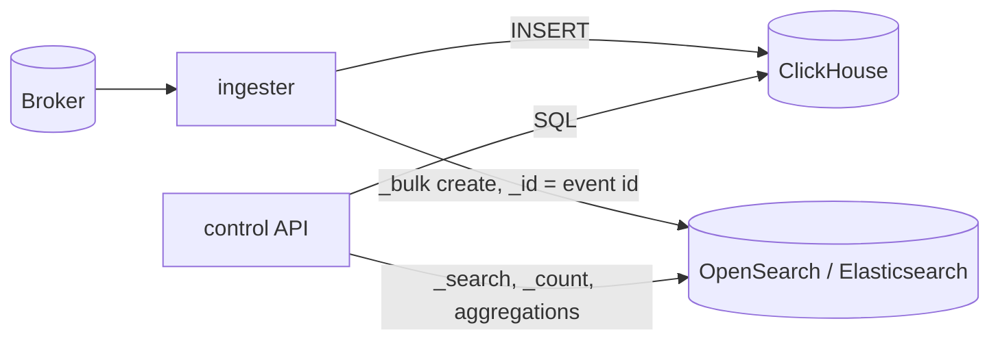

# Capture stores

ProxyX writes every intercepted HTTP exchange and WebSocket message to one **capture store** and answers the [control API](control-api.md) (REST and GraphQL) from it. Two stores are built in:

| | ClickHouse (default) | OpenSearch or Elasticsearch 8 |
|---|---|---|
| Selected by | `capture_store.backend = "clickhouse"` | `capture_store.backend = "opensearch"` |
| Settings | `[clickhouse]` | `[capture_store.opensearch]` |
| Schema applied by | `proxyx migrate control --target clickhouse` | `proxyx migrate control --target opensearch` |
| Duplicate captures | collapse only partly, de-duplicated on read ([capture pipeline](capture-pipeline.md#duplicates-and-deduplication)) | never stored twice (the document id is the capture id) |
| Parquet traffic views | yes | no, `501` |
| Query language | the full [query DSL](control-api.md#query-language) | the full DSL; a few constructs are rejected with `400` ([below](#what-the-opensearch-store-rejects)) |

Nothing else changes: the broker, the proxy, the ingester's session-close logic, Postgres and the API surface are the same for both stores. Choose one store per deployment; captures are not copied between stores.



In the code, the write side is a `CaptureSink` (the ingester's pipeline hands it captures and acks them after a batch is durable) and the read side is a `CaptureStore` (search, count, get by id, WebSocket conversations, request-rate series, time series, scan summary, sequence and the optional Parquet export). The REST handlers and the GraphQL service use only that trait.

## Choosing a store

Pick ClickHouse when you need very large volumes at low cost per row, columnar scans and Parquet exports. Pick OpenSearch or Elasticsearch when you already run it, want retention and access control with the tools you have, or need duplicate-free storage without merge-time effects. The OpenSearch store keeps bodies in a `wildcard` field next to `_source`, so it stores more bytes per capture than ClickHouse's `ZSTD`-compressed columns; plan disk accordingly.

## Switching to OpenSearch

```toml
# control.toml
[capture_store]
backend = "opensearch"

[capture_store.opensearch]
url = "https://opensearch.internal:9200"
username = "proxyx"
password = "..."
ca_cert = "/etc/proxyx/secrets/opensearch-ca.pem"   # optional
index_prefix = "proxyx"
rollover = "daily"                                  # or "weekly"
number_of_shards = 1
number_of_replicas = 1
```

Environment variables use the same names with `__` nesting, for example `PROXYX_CONTROL_CAPTURE_STORE__BACKEND=opensearch` and `PROXYX_CONTROL_CAPTURE_STORE__OPENSEARCH__URL=https://opensearch.internal:9200`. With `backend = "opensearch"` the `[clickhouse]` section is not needed.

1. Run `proxyx migrate control` (or `--target opensearch`) once. It installs two composable index templates, `<index_prefix>-http` and `<index_prefix>-ws`, and applies the Postgres migrations. `--check` verifies the templates and their schema version without changing anything.
2. Start `proxyx control ingester` and `proxyx control api` with the same configuration. The ingester refuses to start when the templates are missing or from an older schema version, because a missing template would let OpenSearch guess the mappings.
3. Re-run `migrate` after upgrading ProxyX if a release changes the schema version. A template change applies to indices created afterwards; existing indices keep the mapping they were created with.

Supported servers: OpenSearch 2.x and 3.x, and Elasticsearch 8. The integration tests pass against OpenSearch 2.19.7, OpenSearch 3.9.0 and Elasticsearch 8.17.0, and against a security-enabled OpenSearch over TLS with basic authentication and a custom CA. The store uses only the REST calls the two share: `_bulk`, composable index templates (`_index_template`), `_search` with `search_after`, `_count`, composite and metric aggregations, `ids` queries and the `wildcard` field type.

### Settings

| Key | Default | Meaning |
|---|---|---|
| `url` | required | Cluster or coordinating-node URL, `http://` or `https://`. Put a load balancer in front of several nodes. |
| `username`, `password` | unset | Basic authentication. |
| `api_key` | unset | Elasticsearch API key (the base64 `encoded` value), sent as `Authorization: ApiKey ...`. Exclusive with `username`. |
| `ca_cert` | unset | PEM file with the CA that signed the server certificate, added to the public roots. TLS uses rustls. |
| `index_prefix` | `proxyx` | Prefix of index and template names: lowercase letters, digits, `.`, `_`, `-`. |
| `rollover` | `daily` | `daily` (`<prefix>-http-2026.11.10`) or `weekly` (`<prefix>-http-2026.w46`, ISO week). The index is chosen by the capture's UTC timestamp. |
| `number_of_shards` | `1` | Template setting `index.number_of_shards`. |
| `number_of_replicas` | `1` | Template setting `index.number_of_replicas`. Use `0` on a single node. |
| `refresh_interval` | `5s` | Template setting `index.refresh_interval`: a write is searchable after this long. |
| `index_settings` | empty | Extra template settings by full name, for retention, see [Retention](#retention). |
| `request_timeout_secs` | `30` | Timeout of searches, counts, aggregations and admin calls (the client-side request timeout). A search also carries a server-side `timeout` of 30 s and fails instead of returning partial results. |
| `bulk_timeout_secs` | `120` | Timeout of one `_bulk` request. |
| `connect_timeout_secs` | `10` | Timeout of establishing a connection (TCP and TLS). |
| `pool_idle_timeout_secs` | `90` | An idle pooled connection is closed after this long; `0` keeps idle connections until the server closes them. Keep it below the idle timeout of any load balancer in front of the cluster, or the next request may hit a connection the balancer already dropped. |
| `pool_max_idle_per_host` | `32` | Idle connections kept per host. |
| `tcp_keepalive_secs` | `60` | TCP keepalive probe interval; `0` disables the probes. |
| `max_retries`, `retry_initial_backoff_ms`, `retry_max_backoff_ms` | `3`, `200`, `5000` | In-place retry budget of a `_bulk` request, see [Resilience and health](#resilience-and-health). |
| `max_bulk_bytes` | `10485760` | A flush is cut into `_bulk` requests of at most this many bytes. |
| `bulk_size`, `flush_interval_secs`, `max_buffer_bytes`, `circuit_breaker_threshold`, `circuit_breaker_reset_secs` | `500`, `5`, `268435456`, `5`, `60` | Batching, backpressure and circuit breaker; they behave exactly as the [ClickHouse settings of the same name](capture-pipeline.md#batch-flushing-and-backpressure) and report the same metrics (`table` is `http_captures` or `ws_messages`). See [Resilience and health](#resilience-and-health). |

## How captures are written

The ingester normalizes a capture exactly as for ClickHouse (decoded bodies, correlation headers, clamped numbers) and appends it to a `_bulk` request as

```json
{"create": {"_index": "proxyx-http-2026.11.10", "_id": "018f3a52-..."}}
{"id": "018f3a52-...", "org_id": "acme", "timestamp": 1700000000123, ...}
```

- **Idempotent.** `_id` is the capture's `event_id` and the operation is `create`. A second write of the same capture, whether the broker redelivered the message (Case A in [capture pipeline](capture-pipeline.md#duplicates-and-deduplication)) or the proxy published it twice (Case B), answers `409 version_conflict_engine_exception`. The ingester counts a `409` as written. So with this store the duplicate caveat of the capture pipeline does not exist: searches, counts, aggregations and sequences never see a capture twice, and no query needs to de-duplicate.
- **Ack after write.** As with ClickHouse, a message is acked only after its batch was written. Per item: `2xx` and `409` are written; `429` and `5xx` are first retried in place with backoff and then, if still failing, go back into the buffer and are retried at the next flush ([Resilience and health](#resilience-and-health)). Per-item `401` and `403` retain the affected documents without acknowledgement or in-place retries and count as a failed flush toward the circuit breaker, just like request-level authorization failures. Other `4xx` (for example a mapping error) make that document a poison row: it is dropped, counted in `proxyx_ingester_rows_dropped_total{table}`, logged with its event id and acked. A failed request retains the whole remaining batch and counts toward the circuit breaker.
- **Index per period.** The index is derived from the capture's timestamp, so a redelivery after midnight still lands in the index of the original write and deduplicates there.
- **Delay.** A capture is visible to searches after `refresh_interval` (default 5 s). `GET /rpc/processed` and the session close logic do not wait for the refresh: they mean "durably written", not "searchable yet".

## Resilience and health

The write path has two layers of protection, both shared in shape with the ClickHouse handler.

**In-place retry with backoff (OpenSearch store).** A `_bulk` request that fails transiently (connection error, timeout, HTTP `429`, `5xx`) is sent again, at most `max_retries` times (default 3), after `retry_initial_backoff_ms` (default 200 ms), doubling each time up to `retry_max_backoff_ms` (default 5 s), with up to 25 % jitter. When the request succeeded but some items answered `429` or `5xx`, only those documents are sent again. Permanent failures are not retried in place: authentication or authorization errors (`401`, `403`), a malformed request, and items answered with another `4xx` (those are poison rows, dropped and acked as described above). Each retry round increments `proxyx_ingester_store_retries_total{table}`. `max_retries = 0` turns the in-place retry off. The retry budget is bounded: at the defaults one request waits at most about 0.2 + 0.4 + 0.8 s plus jitter plus the attempts themselves.

**Circuit breaker (both stores).** A flush that still has unwritten rows after the retry budget (OpenSearch) or whose insert fails (ClickHouse) puts those rows back in the buffer and counts as a failure. After `circuit_breaker_threshold` consecutive failures (default 5) the breaker opens for `circuit_breaker_reset_secs` (default 60): flushes are skipped, rows accumulate up to `max_buffer_bytes`, then the ingester stops reading from the broker, so nothing is dropped. After the window the next flush is attempted without a probe phase; one more failure re-opens the breaker at once and the first success closes it. The state is the gauge `proxyx_ingester_circuit_open{table}`; flush outcomes and durations are `proxyx_ingester_flush_duration_seconds{table,outcome}`. Details of the buffer and the breaker: [capture pipeline](capture-pipeline.md#batch-flushing-and-backpressure).

**Ingester health.** `GET /health` on the ingester port (`ingester_health_addr`, default 9001) is `503` while the breaker of either table is open (and, as before, once the consumer task has exited), so a probe or an orchestrator sees an ingester that cannot write. "Open" here means the same as the gauge: from the failure that tripped the breaker until the next successful flush, including the half-open attempt after the reset window. The breaker only trips on flushes, so an ingester with nothing to write does not notice an outage until the next capture arrives; use `GET /health/store` on the API for an active check.

**API store health.** `GET /health/store` on the API port probes the configured store (`GET /` on OpenSearch, which verifies reachability and credentials; `SELECT 1` on ClickHouse) with a 3 s limit and answers `200 {"store":"opensearch","status":"ok"}` or `503` with `"status"` `unreachable` or `timeout` and an `error`. `GET /health/ready` stays on Postgres and Redis only, so a slow store never takes the session API out of rotation. Searches that reach a store which is down fail with `500` after the request timeout; they are not short-circuited by the write-side breaker.

**HTTP client.** One connection pool per process, shared by writes, searches and the health probe: `connect_timeout_secs`, `request_timeout_secs` (searches and admin calls), `bulk_timeout_secs` (one `_bulk`), `pool_idle_timeout_secs`, `pool_max_idle_per_host` and `tcp_keepalive_secs` are all configurable ([Settings](#settings)). Tune the idle timeout below any intermediate idle timeout, and the keepalive to detect half-open connections through NATs.

## Documents and mappings

The templates use `dynamic: strict`: a field the mapping does not know is rejected, never guessed. A capture document holds the columns of the ClickHouse table with these types:

| Field | Type | Notes |
|---|---|---|
| `id`, `org_id`, `source`, `source_id`, `proxy_id`, `session_id`, `method`, `scheme`, `host` | `keyword` | |
| `timestamp` | `date` | epoch milliseconds, UTC |
| `session_offset` | `long` | broker position; values above 2^63 - 1 are clamped |
| `path`, `request_body`, `response_body` | `wildcard` | substring, exact and regular-expression matching without a length limit |
| `request_headers`, `response_headers` | `object`, not indexed | `[{"name": ..., "value": ...}]`, in wire order, returned by searches |
| `request_size`, `response_size`, `duration_ms`, `ratelimit_wait_ms` | `long` | clamped to the ClickHouse column width |
| `status_code` | `integer` | |
| `correlation_id`, `parent_correlation_id`, `account_id`, `tool_call_id` | `keyword` | absent (not an empty string) when `NULL` |

WebSocket messages (`<prefix>-ws-*`) carry `id`, `parent_event_id`, `org_id`, `timestamp`, `session_offset`, `direction` (`c2s` or `s2c`), `opcode` (`text`, `binary`, `close`, `ping`, `pong`), `session_id`, `proxy_id`, `source`, `source_id`, `host`, `payload` (`wildcard`), `payload_size`, `payload_truncated`, `payload_is_text`, `was_compressed`, `close_code` and `close_reason`. A payload that is not valid UTF-8 is indexed (and returned) as its lossy UTF-8 conversion without NUL characters; `len.payload` and `payload_size` keep the byte counts.

**Derived fields.** ClickHouse computes some values when it runs a query; this store computes them when it ingests, so the query semantics are the same:

| Field | Holds | Serves |
|---|---|---|
| `len.<column>` | byte length of the column's value (absent for `NULL`) | `length` filters |
| `mime_type` | first response `Content-Type`, parameters cut at `;`, trimmed of spaces, ASCII-lowercased; empty without the header | `mime_type` filter, ordering by `mime_type` |
| `request_sends_cookies`, `response_sets_cookies`, `cookies` | a `Cookie` request header, a `Set-Cookie` response header, how many of the two | cookie filters, ordering by `cookies` |
| `request_header_kv`, `response_header_kv` | one `lowercase-name:value` term per header | `request_header` and `response_header` filters |
| `url_sort` | `host` + `path`, cut at 4096 bytes | ordering by `url` |

## What the OpenSearch store rejects

A query construct that cannot be lowered exactly fails with `400` (REST) or a GraphQL error naming the construct, before any search runs. The store never answers with a different set of rows than ClickHouse would.

- **Regular expressions** (`regex_match`). ClickHouse matches RE2 unanchored; OpenSearch has Lucene regular expressions with different syntax. ProxyX translates the subset that means the same in both and rejects the rest:
  - translated: literals, `.` (not matching a newline, as in RE2), character classes of literals, ranges and ASCII classes (`[[:alpha:]]`), `\d \D \w \W \s \S` with their ASCII meaning, groups, alternation, `? * + {n} {n,} {n,m}` (lazy forms too), `^` and `$` (or `\A`, `\z`) at the start or end of a top-level alternative, and `(?i)` as the first thing in the pattern, which folds non-ASCII letters too (Unicode simple case folding, as RE2 does);
  - rejected: `\b` and other assertions, `\p{...}` and other Unicode classes, any other flag or an inline flag group, anchors in the middle of a pattern, set operations and nested classes, negated ASCII classes inside a class, a range with a non-ASCII end under `(?i)`, a pattern anchored at both ends that spells out more than 65 536 bytes.

  A pattern whose automaton is too large for the server (`too_complex_to_determinize_exception`) is also rejected with `400`.
- **Header filters with an empty value** (`request_header` or `response_header` with `"value": ""`). In ClickHouse `headers[key] = ''` also matches rows that lack the header, which this store cannot express.
- **A cursor from another order** is rejected as in ClickHouse.

### Differences that are not rejected

Everything the DSL means for `NULL` is kept: `not`, `any` and `all` follow SQL three-valued logic, so `not(exact "x")` on `correlation_id` does not match captures without a correlation id, exactly like ClickHouse. These differences remain:

- `contains` folds case with Unicode simple case folding (`ÜNÏ` matches `ünï`, `k` matches U+212A KELVIN SIGN, `s` matches U+017F LATIN SMALL LETTER LONG S); ClickHouse's `lower` folds ASCII only, so text that differs only in non-ASCII case matches here and not there. `(?i)` folds Unicode in both stores.
- `status_code` and `close_code` are 32-bit `integer` fields. A comparison against a value beyond that range is decided without a search: `exact`, `gt` or `gte` above the maximum and `lt` or `lte` below the minimum match nothing, the opposite comparisons match every capture, as in ClickHouse.
- Header values longer than 8191 characters are stored but not indexed for the exact header filter; the proxy cuts header values at `max_header_capture` (512 bytes by default). Both stores match header names case-insensitively and values exactly.
- Ordering by `url` compares the first 4096 bytes of `host` + `path`.
- `session_offset` is a signed 64-bit field.
- A binary WebSocket payload is searched as its lossy UTF-8 conversion; ClickHouse searches the raw bytes.
- Counts and aggregations are exact, with two bounded exceptions: the total of `wsConversations` is a cardinality aggregation that is exact up to 40 000 conversations, and the conversation list takes each shard's top 10 000 conversations by last activity before merging, so it is exact unless one index holds more matching conversations than that.
- `count` follows the cursor like it does in ClickHouse (it counts what comes after the cursor), and `totalCount` in GraphQL inherits that.
- `requestRateSeries`, `httpTrafficTimeSeries` and `scanTrafficSummary` count each capture once; in ClickHouse a replay can inflate them.

## Retention

Retention is the cluster's job. The templates carry whatever you put in `index_settings`, so a lifecycle policy attaches to every new index.

OpenSearch (Index State Management): create the policy, then reference it.

```json
PUT _plugins/_ism/policies/proxyx-retention
{"policy": {"description": "delete captures after 90 days", "default_state": "hot",
  "states": [
    {"name": "hot", "actions": [], "transitions": [{"state_name": "delete", "conditions": {"min_index_age": "90d"}}]},
    {"name": "delete", "actions": [{"delete": {}}], "transitions": []}],
  "ism_template": [{"index_patterns": ["proxyx-*"], "priority": 100}]}}
```

```toml
[capture_store.opensearch.index_settings]
"index.plugins.index_state_management.policy_id" = "proxyx-retention"
```

(An `ism_template` entry as above attaches the policy to new matching indices by itself; the setting is the explicit alternative.)

Elasticsearch (index lifecycle management):

```json
PUT _ilm/policy/proxyx-retention
{"policy": {"phases": {"delete": {"min_age": "90d", "actions": {"delete": {}}}}}}
```

```toml
[capture_store.opensearch.index_settings]
"index.lifecycle.name" = "proxyx-retention"
```

Because indices are named by period, you can also delete old ones directly: `DELETE proxyx-http-2026.08.*`. Deleting an index of a session that is still open loses its captures; the API's reads of the missing period return nothing, not an error. `migrate` never deletes indices or templates.

## Traffic view exports

`POST /rpc/views`, `GET /rpc/views/{id}` and the GraphQL `createTrafficView` and `trafficView` answer `501 Not Implemented` with `traffic view exports are not supported by the opensearch capture store`. The ClickHouse export writes Parquet straight from the database to object storage with a table function; OpenSearch has no equivalent, and a scroll-and-convert exporter in the API process would put the full capture volume through it. To get Parquet from this store, read it with `POST /rpc/requests/search` (cursor paging) or use the cluster's snapshot and reindex tooling. The `traffic_views_*` and `export_*` settings are ignored with this backend.

## Running it locally

```sh
docker compose -f docker/docker-compose.yml --profile opensearch up -d opensearch
export PROXYX_CONTROL_CAPTURE_STORE__BACKEND=opensearch
export PROXYX_CONTROL_CAPTURE_STORE__OPENSEARCH__URL=http://127.0.0.1:9200
proxyx migrate control
```

The compose `opensearch` service is a single node with security disabled, for development only. If the node refuses to create indices on a nearly full disk, it has hit its disk watermarks; free space or relax them (`cluster.routing.allocation.disk.threshold_enabled=false`) on a throwaway node.

## Testing

The unit tests of the lowering compare the generated search JSON with golden files in `crates/control/src/capture_store/opensearch/golden/` (set `UPDATE_GOLDEN=1` to rewrite them after an intended change). The integration tests in `crates/control/tests/capture_store_opensearch.rs` run against a real node and are skipped with a message unless `PROXYX_TEST_OPENSEARCH_URL` is set:

```sh
docker run -d --name proxyx-os -p 45592:9200 -e discovery.type=single-node \
    -e DISABLE_SECURITY_PLUGIN=true opensearchproject/opensearch:2
PROXYX_TEST_OPENSEARCH_URL=http://127.0.0.1:45592 cargo test -p proxyx-control --test capture_store_opensearch
```

They cover write, search, count and get for every filter operator, cursor paging in every order, redelivery without duplicates, WebSocket messages and conversations, and the aggregations. Against Elasticsearch use `-e xpack.security.enabled=false docker.elastic.co/elasticsearch/elasticsearch:8.17.0` instead. A secured cluster is reached with `PROXYX_TEST_OPENSEARCH_USER`, `PROXYX_TEST_OPENSEARCH_PASSWORD` (or `PROXYX_TEST_OPENSEARCH_API_KEY`) and `PROXYX_TEST_OPENSEARCH_CA_CERT`. The tests run one at a time because index creation is a cluster-state update; on a host whose disk is above the high watermark start the node with `-e cluster.routing.allocation.disk.threshold_enabled=false`.

`crates/control/tests/capture_store_clickhouse.rs` runs the same pipeline (write through `RequestPipeline`, ack after flush, read through `CaptureStore`) against a real ClickHouse; it needs `PROXYX_TEST_CLICKHOUSE_URL` (and `PROXYX_TEST_CLICKHOUSE_USER` / `PROXYX_TEST_CLICKHOUSE_PASSWORD`) and `PROXYX_CONTROL_CLICKHOUSE__LOCAL_SINGLE_NODE=1`, and creates and drops its own database.
