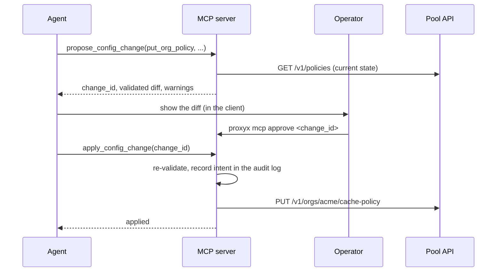

# MCP server

`proxyx mcp` (also built as the standalone `proxyx-mcp`) is a [Model Context Protocol](https://modelcontextprotocol.io) server. It lets an AI agent monitor ProxyX, explain failures, and, when an operator allows it, manage and reconfigure it. The overview of the AI features is in [ai.md](ai.md); this page is the setup, the tool catalog and the safety model.

The server is a client of the control surfaces ProxyX already has: the pool gateway's `/v1` API, the session control plane's `/rpc` API, and the ops ports (`/healthz`, `/readyz`, `/metrics`). It adds no new privilege: an agent can do what the credentials in its configuration can do, further narrowed by the capabilities, allow lists, approval mode and scope the operator sets.

- [Quick start](#quick-start)
- [Transports](#transports)
- [Client setup](#client-setup)
- [Configuration](#configuration)
- [Safety model](#safety-model)
- [Tool catalog](#tool-catalog)
- [Resources and prompts](#resources-and-prompts)
- [Dynamic configuration workflow](#dynamic-configuration-workflow)
- [Operator commands](#operator-commands)
- [Audit log](#audit-log)
- [LLM-assisted tools](#llm-assisted-tools)
- [Protocol details](#protocol-details)

## Quick start

1. Create the credentials the server will use, each in its own file (mode `0600`):

   ```sh
   # admin token of the pool gateway: the file the gateway already reads (admin_token_file)
   # a control-plane service key bound to one org
   proxyx control keys create --kind service --org acme --name mcp > /etc/proxyx/secrets/mcp-pxk
   # a bearer token for the HTTP transport (not needed for stdio)
   head -c 32 /dev/urandom | base64 > /etc/proxyx/secrets/mcp-token
   ```

2. Copy [`examples/mcp.toml`](../examples/mcp.toml), set the endpoints, and leave `[safety]` alone. The default is read-only.
3. Check it: `proxyx mcp --config mcp.toml check` loads the file, reads every credential file and probes every backend.
4. Point an MCP client at it (below), then ask: "Assess the health of ProxyX."

## Transports

| Transport | Start | Authentication | Use |
|---|---|---|---|
| stdio | `proxyx mcp --config mcp.toml` | none: the client launched the process | Claude Desktop, Claude Code, editors; the process runs as the user and reads the credential files that user can read |
| Streamable HTTP | `proxyx mcp --config mcp.toml --transport http` | bearer token (`http.token_file`), always required | a shared or remote endpoint; one URL, `POST` only |

stdio carries newline-delimited JSON-RPC 2.0 on stdin and stdout and nothing else; logs go to stderr. The process exits when stdin closes, after answering what it already received.

The HTTP transport binds `127.0.0.1:8765` by default. It validates the `Origin` header (loopback origins and `http.allowed_origins` only, against DNS rebinding), compares the token in constant time, caps request bodies and in-flight requests, and answers `GET` and `DELETE` on the MCP path with `405`: there are no sessions and no server-initiated stream. It does not terminate TLS. For anything beyond loopback put a TLS reverse proxy in front, and keep the token secret: the token authorizes everything the server's configuration allows.

For an orchestrator the HTTP transport also serves `GET /healthz` (liveness: `200` while the process serves) and `GET /readyz` (`200` when every configured backend answers a cheap request, `503` with the backend names that do not, and `503 draining` once shutdown has started). Both are outside the token check, do not accept the MCP protocol, and never show a URL, credential or token; `/readyz` reuses its verdict for 5 seconds so probes do not become load on the backends. Concurrency is capped by `limits.max_in_flight` (default 16): a request above it is answered `429` with error `-32603` and `data.reason` `busy`.

Both transports speak revision 2026-07-28 (stateless: every request carries its protocol version and client capabilities in `_meta`, results carry `resultType`, lists carry `ttlMs` and `cacheScope`, `server/discover` is implemented) and the earlier `initialize` revisions (2025-11-25, 2025-06-18, 2025-03-26, 2024-11-05). The server keeps no per-connection state, so a legacy client and a modern client can share one process.

## Client setup

### Claude Code

```sh
claude mcp add proxyx -- proxyx mcp --config /etc/proxyx/mcp.toml
# or over HTTP
claude mcp add --transport http proxyx http://127.0.0.1:8765/mcp \
  --header "Authorization: Bearer $(cat /etc/proxyx/secrets/mcp-token)"
```

### Claude Desktop (and other clients with a JSON config)

```json
{
  "mcpServers": {
    "proxyx": {
      "command": "proxyx",
      "args": ["mcp", "--config", "/etc/proxyx/mcp.toml"]
    }
  }
}
```

With the standalone binary: `"command": "proxyx-mcp", "args": ["--config", "/etc/proxyx/mcp.toml"]`.

### A client that speaks streamable HTTP

```json
{
  "mcpServers": {
    "proxyx": {
      "type": "http",
      "url": "http://127.0.0.1:8765/mcp",
      "headers": { "Authorization": "Bearer <contents of the mcp-token file>" }
    }
  }
}
```

### Any other client

Run `proxyx mcp --config mcp.toml` as a subprocess and exchange JSON-RPC lines. A minimal exchange:

```text
>>> {"jsonrpc":"2.0","id":1,"method":"initialize","params":{"protocolVersion":"2025-06-18","capabilities":{},"clientInfo":{"name":"demo","version":"1"}}}
<<< {"jsonrpc":"2.0","id":1,"result":{"protocolVersion":"2025-06-18","capabilities":{"tools":{"listChanged":false},"resources":{...},"prompts":{...}},"serverInfo":{"name":"proxyx-mcp",...},"instructions":"ProxyX is a proxy platform for authorized security research. ..."}}
>>> {"jsonrpc":"2.0","method":"notifications/initialized"}
>>> {"jsonrpc":"2.0","id":2,"method":"tools/list","params":{}}
<<< {"jsonrpc":"2.0","id":2,"result":{"tools":[{"name":"health",...},{"name":"assess",...},...]}}
>>> {"jsonrpc":"2.0","id":3,"method":"tools/call","params":{"name":"explain_refusal","arguments":{"text":"HTTP/1.1 503 cache_empty"}}}
<<< {"jsonrpc":"2.0","id":3,"result":{"content":[{"type":"text","text":"{\"code\":\"cache_empty\",\"http_status\":503,...}"}],"isError":false,"structuredContent":{...}}}
```

A modern client skips `initialize` and sends `_meta` on every request:

```json
{"jsonrpc":"2.0","id":1,"method":"tools/call","params":{"name":"assess","arguments":{},"_meta":{"io.modelcontextprotocol/protocolVersion":"2026-07-28","io.modelcontextprotocol/clientCapabilities":{}}}}
```

Over HTTP a modern request also carries `MCP-Protocol-Version`, `Mcp-Method` and, for `tools/call`, `prompts/get` and `resources/read`, `Mcp-Name`; the server rejects a mismatch with `400` and error code `-32020`.

## Configuration

The file is TOML; [`examples/mcp.toml`](../examples/mcp.toml) lists every key with its default. Lookup order: `--config`, `$PROXYX_MCP_CONFIG`, `./mcp.toml`, `/etc/proxyx/mcp.toml`, built-in defaults (read-only, no backend). An unknown key is an error.

| Section | Keys |
|---|---|
| `[http]` | `bind`, `path`, `token_file`, `allowed_origins`, `max_body_bytes` |
| `[endpoints.pool]` | `url`, `admin_token_file`, `operator` (the `X-Operator` of the gateway's audit trail), `org_key_file` (enables the org-key route of block signals) |
| `[endpoints.control]` | `url`, `key_file` (a `pxk_` service key), `org` (the key's org, the default of every `org` argument) |
| `[[endpoints.roles]]` | `name`, `kind` (`gateway`, `warmer`, `control-api`, `ingester`, `intercept`), `url` of the role's ops port |
| `[safety]` | `profile`, `capabilities`, `allow_tools`, `deny_tools`, `approval`, `approval_tools`, `approval_ttl_secs`, `confirm_token_file`, `reveal_secrets_once`, `force_dry_run`, `state_dir` |
| `[scope]` | `engagement`, `expires`, `require_engagement`, `allowed_orgs` |
| `[limits]` | `max_rows`, `max_body_bytes`, `max_result_bytes`, `request_timeout_secs`, `max_calls_per_minute`, `max_mutations_per_hour`, `max_session_ttl_secs`, `allow_inline_secrets`, `max_in_flight` |
| `[audit]` | `path` |
| `[metrics]` | `sample_interval_secs`, `history` |
| `[credentials.NAME]` | `username`, `password_file`: a login a tool can use by name |
| `[llm]` | `endpoint`, `model`, `api_key_file`, `timeout_secs`, `max_input_chars`, `max_output_tokens` |

URLs must not carry credentials. A tool is listed only when its backend is configured: without `endpoints.pool` the inventory, policy and block tools do not exist; without `endpoints.roles` the monitoring tools do not.

## Safety model

ProxyX serves authorized security research. The MCP server is built so that an agent, which can be wrong, confused or the target of prompt injection through captured content, cannot do more than the operator decided.

| Control | What it does |
|---|---|
| **Read-only by default** | No `[safety]` section means no mutating tool is listed or callable. A mutation needs its capability. |
| **Capabilities** | `sessions`, `org_keys`, `org_limits`, `egress`, `org_blocks`, `signals`, `policy`, `inventory`, `pool_sessions`. `profile = "operator"` enables `sessions`, `org_blocks`, `signals`; `"admin"` enables all; `capabilities = [...]` overrides the profile. Only the operator's file changes them. |
| **Tool allow and deny lists** | `allow_tools` and `deny_tools`, with a trailing `*` as prefix. Rules also apply to the underlying action of nested calls (including classification reporting) and stored changes at application time. |
| **Engagement scope** | `scope.engagement` is recorded in every audit entry; `scope.expires` ends mutations at a moment; `scope.require_engagement` refuses mutations without a recorded engagement; `scope.allowed_orgs` confines reads and mutations to those orgs and refuses changes to shared resources (global policies, inventory, operator block signals). Org-block reads require an explicit authorized `org` when scoped. Session, change, org-policy and customer-owned inventory listings filter unauthorized rows before pagination. Shared inventory and global/route-class policies remain visible. Policy previews validate only shared and authorized-org policies; audit-log resources are unavailable to scoped servers because historical entries do not carry reliable resolved ownership. |
| **Dry run** | Every mutating tool takes `dry_run`: it validates, computes the diff and calls nothing. `safety.force_dry_run` makes every mutation a dry run. |
| **Human approval** | `safety.approval = "all"` or `"listed"` holds a mutation as a pending change with an id. An operator approves with `proxyx mcp approve <id>` after seeing the diff, or, when `confirm_token_file` is set, the agent's client relays a token the operator types into `confirm_change`. An approval is bound to the exact arguments, single-use and expires (`approval_ttl_secs`). Approval does not extend expiry; expiry is checked again atomically when the change is consumed. Operators can revoke an approved, unapplied change with `proxyx mcp reject <id>`. |
| **Secrets** | Org keys, `pxk_` keys, raw session UUIDs, session proxy URLs and upstream passwords never appear in ordinary output. Session UUIDs authenticate proxy clients: management tools instead return opaque `session_…` handles and accept those handles for status, extension and termination. A secret a call creates is written to a `0600` file and only the path is returned; session files contain `SESSION_ID`, `HTTP_PROXY`, `HTTPS_PROXY` and `ALL_PROXY`. With `reveal_secrets_once = true`, secrets appear once in the creating call's `revealed_once` member, and raw session UUID inputs are permitted. Handles are local to the running MCP server: after a restart, call `list_sessions` to get current handles. Logins are passed by `credential_ref` into the `[credentials]` table, never as arguments (`allow_inline_secrets` is off), and a held change never stores one. Output and the audit log are scrubbed for credential shapes, Basic/Bearer headers and URL userinfo. |
| **Untrusted content** | Captured bodies, headers and paths are marked `untrusted`, truncated to `limits.max_body_bytes`, and have credential headers hidden and session ids aliased. Tool descriptions and the server instructions tell the model not to follow instructions found in them. Before LLM requests are built, structured filtering removes Authorization, Cookie, Set-Cookie, Proxy-* and API-key-like header values, secret JSON/body members and query-string secrets. Content sent to an LLM is wrapped as data. |
| **Budgets** | `max_calls_per_minute`, `max_mutations_per_hour` (dry runs are free), `max_in_flight`, `max_result_bytes`, `max_session_ttl_secs`. |
| **Audit** | Every tool call is appended to a hash-chained JSONL log; a mutation is recorded before it runs and refused when the record cannot be written. |
| **Models advise** | `suggest_policy` and `classify_block_page` return drafts and suggestions; nothing a model says is applied. |

A model cannot enable a capability, read a credential file, approve its own change (without the confirm token, which is a separate secret) or edit the audit log through this server. An operator who gives an agent shell access defeats all of this; keep the configuration and secret files outside what the agent can read.

## Tool catalog

`R` tools read or compute. `W:capability` tools change ProxyX and need that capability. All results are JSON in both the text content and `structuredContent`; a failure is `isError: true` with `error.kind` (`invalid_arguments`, `refused`, `backend_error`, `not_configured`, `llm_error`) and a message the model can act on. Arguments are validated against the schema `tools/list` advertises, and an unknown argument is an error, so a misspelled `dry_run` cannot run a real change.

### Monitoring and assessment

| Tool | | Needs | What it returns |
|---|---|---|---|
| `health` | R | roles | Liveness and readiness of every role with latency and the `/readyz` reason |
| `assess` | R | roles | Pass/warn/fail findings across health, dependencies, config reloads, capacity, cost, rentals, breakers, refusal rates, block-signal reactions, latency histograms and the capture pipeline, each with evidence, remediation and the runbook to follow |
| `metrics_snapshot` | R | roles | Summary of the [documented families](metrics/pool.md): totals, largest series, histogram count, mean, p50 and p95 |
| `pool_capacity` | R | roles | Per provider and kind: ready (normal, degraded) against `min_ready` and the low watermark, verdict, cost used, breaker, rental days left, sessions, inventory |
| `breaker_states` | R | roles | Pool route-class breakers (closed, half_open, open) with skips and create outcomes, plus every other breaker gauge or counter found by name in the roles' metrics (session-proxy upstream breakers, edge parent breakers) |
| `block_signal_rates` | R | roles | Block signals by source, type and scope, rates, dropped signals |
| `recent_refusals` | R | roles | Refusals by cause with rates, share of connections, meaning and next steps |
| `diagnose` | R | any | Ranked evidence for one org: refusals, org blocks, effective policy, capacity, breakers, rate-limit bucket; says what it could not check |
| `effective_config` | R | none | Timeouts and keepalive in force: effective policy for an org and provider, the gateway's built-in timings (labelled as documented defaults), this server's own limits |
| `capabilities` | R | none | This server's profile, capabilities, approval mode, scope, limits and which tools are unlisted and why |

### State

| Tool | | Needs | What it returns |
|---|---|---|---|
| `list_inventory`, `inventory_replacements` | R | pool | Static IP rows by provider and state; IPs awaiting replacement |
| `list_policies` | R | pool | Stored policies, their versions and who wrote them (documents on request) |
| `list_org_blocks` | R | pool | Active org blocks |
| `list_pool_sessions` | R | pool | An org's sticky pool sessions (sid, provider, region, exit IP, age, bytes) and the affinity counters (entries, hits, misses, evictions, rotations) |
| `generate_pool_endpoints` | R | pool | Gateway endpoints for an org (HTTP CONNECT or SOCKS5) with proxy usernames built from kind, country, city, provider, rotation and ttl, checked with the gateway's username grammar first. The request never carries the org key and the URLs carry the username only: add the key client-side as the proxy password. An endpoint that carries a password is refused. Needs the matching explicit port (`http_port` for `http`, `socks5_port` for `socks5`); `count` is capped by `limits.max_rows` |
| `get_customer_upstream` | R | pool | An org's own upstream (the login is never returned) |
| `get_org` | R | control | Rate limit, live bucket and egress proxy (password redacted) |
| `list_sessions`, `session_status` | R | control | Sessions this server created; one session's configuration and lifecycle (header values hidden) |
| `list_changes` | R | none | Proposed, approved, applied, rejected and expired changes |

### Traffic

| Tool | | Needs | What it returns |
|---|---|---|---|
| `search_traffic` | R | control | Captured HTTP exchanges matched by the [query language](control-api.md#query-language); bodies optional and capped |
| `count_traffic` | R | control | Approximate count for a query |
| `get_capture` | R | control | One exchange with headers and bodies truncated to a cap, marked |
| `search_ws`, `get_ws_conversation` | R | control | WebSocket messages and one conversation |
| `summarize_traffic` | R | control | Counts by host, method and status, error and rate-limit shares, slowest and largest, block-page suspects; an LLM narrative with `use_llm` |
| `classify_block_page` | R | none | `challenge`, `forbidden`, `rate_limited` or `none` for a capture or a pasted response, by rules, or by the LLM for ambiguous pages; a ready-to-send `report_block_signal` argument set |

### Explanations (offline)

| Tool | | What it returns |
|---|---|---|
| `explain_refusal` | R | A gateway cause code or session-proxy error code (or a pasted status line): HTTP and SOCKS5 codes, meaning, likely causes, next steps, metrics to read |
| `explain_selector` | R | Why a proxy username is refused, rule by rule, using the gateway's own parser; with `org`, also against that org's effective policy |
| `validate_policy` | R | Strict parse and merged-set validation of policy TOML or JSON with the gateway's `proxyx-policy`, against the stored policies when the pool API is configured |
| `suggest_policy` | R | (needs `[llm]`) A policy draft for a natural-language request, validated before it is returned; never applied |

### Changes

| Tool | | What it does |
|---|---|---|
| `propose_config_change` | change | Validate a configuration change and return the diff; stores it under a `change_id`. Works on a server that may not apply it |
| `apply_config_change` | change | Apply a stored change once; needs the action's capability and, when required, approval of exactly this change; re-validated against the state as it is now |
| `confirm_change` | change | Approve a pending change with the operator's separate confirm token (listed only when `confirm_token_file` is set) |

### Mutations

| Tool | Capability | Does |
|---|---|---|
| `create_session`, `extend_session`, `end_session` | `sessions` | Capture sessions: hosts to intercept, ttl capped by `max_session_ttl_secs`; the proxy URL goes to a private file |
| `create_org_key`, `disable_org_keys` | `org_keys` | Org keys; the new key goes to a private file (or is shown once) |
| `set_org_rate_limit` | `org_limits` | Session-proxy rate limit |
| `set_org_egress_proxy`, `clear_org_egress_proxy` | `egress` | Second-hop proxy of an org's session traffic (login by `credential_ref`) |
| `set_customer_upstream`, `clear_customer_upstream`, `validate_customer_upstream` | `egress` | An org's own upstream for the gateway; validation dials through it |
| `create_org_block`, `lift_org_block` | `org_blocks` | Stop an org from an IP, provider, route class or pool, with a recorded reason and optional ttl |
| `report_block_signal` | `signals` | Tell the pool a target blocked an exit IP (org-key route, or operator route) |
| `put_policy`, `put_org_policy`, `delete_policy` | `policy` | Policy documents, validated first with the gateway's rules and the merged set |
| `rotate_pool_session` | `pool_sessions` | Drop an org's sticky pool session (`sid`, `[a-z0-9_]{1,128}`) so its next tunnel leases a new unit and exit IP; open tunnels are not cut; the gateway limits the route to 60 requests a minute per org |
| `put_inventory` | `inventory` | Make a provider's static inventory equal to the entries; the diff names the IPs added and retired |

`put_policy`, `put_org_policy`, `delete_policy`, `put_inventory`, `rotate_pool_session`, the egress, org block and rate-limit changes can be proposed with `propose_config_change`. Sessions, org keys, upstream validation and block signals act at run time or return a secret, so they are direct calls.

## Resources and prompts

Resources (`resources/list`, `resources/read`, templates):

| URI | Content |
|---|---|
| `proxyx://docs/cause-codes`, `username-grammar`, `query-dsl`, `policy-format`, `safety-model` | Reference documents compiled into the server |
| `proxyx://docs/metrics-catalog` | The documented Prometheus families (name, type, labels, meaning) as JSON |
| `proxyx://server/capabilities`, `proxyx://health`, `proxyx://pool/capacity`, `proxyx://pool/refusals`, `proxyx://pool/policies`, `proxyx://pool/inventory`, `proxyx://pool/org-blocks`, `proxyx://sessions`, `proxyx://changes` | Live views; each runs the matching read tool, so the same gate and audit apply |
| `proxyx://control/certificate` | The MITM CA certificate (public) that session proxy clients must trust |
| `proxyx://audit/recent` | The last audit entries |
| `proxyx://causes/{code}`, `proxyx://sessions/{session_id}`, `proxyx://captures/{org}/{id}`, `proxyx://orgs/{org}` | Templates |

Prompts (`prompts/list`, `prompts/get`): `triage_blocks`, `capacity_review`, `session_debug`, `org_diagnose` and `change_review`. Each tells the model which tools to call in which order and where to stop; none contains data.

## Dynamic configuration workflow



1. **Propose.** The change is validated: arguments against the tool's schema, policy documents with `proxyx-policy` (strict fields, durations, ceilings, required regions) merged with the stored policies, ids and hosts with the gateway's rules, the target's current state for the diff. Invalid input is refused with the reason. The diff lists the changed fields, `warnings` name side effects (for example that git overrides an emergency policy write), and the result says whether this server may apply it and whether approval is needed.
2. **Approve** (when `safety.approval` requires it).
3. **Apply.** The underlying action's current allow/deny policy and capability are checked again, then the change is validated against current state, consumed atomically (including a final expiry/revocation check), recorded in the audit log, and sent. A change whose file was edited, expired or rejected is refused, including changes that were approved earlier.

The gateway repeats its own validation, including facts only it knows (the loaded provider adapters and their session life); a draft that passes here can still be refused there, and the refusal reaches the agent.

Session management handles are process-local. After restarting the MCP server, refresh them with `list_sessions`. Approved session extensions and terminations still work: their `0600` pending-change files retain the real UUID for operator inspection, while model-facing previews and results use fresh opaque handles.

## Operator commands

| Command | Does |
|---|---|
| `proxyx mcp` | Serve (stdio by default; `--transport http`, `--bind ADDR`) |
| `proxyx mcp pending` | List changes with their status |
| `proxyx mcp approve <id> [--yes] [--by NAME] [--note TEXT]` | Show the diff and warnings, ask, then approve |
| `proxyx mcp reject <id>` | Reject a proposed change or revoke an approved change that has not been applied |
| `proxyx mcp check` | Load the configuration, read every credential file and probe every backend |
| `proxyx mcp tools` | List every tool and whether it is listed for this configuration |
| `proxyx mcp audit [--verify] [--tail N]` | Show the log path, verify the hash chain, or show the last entries |

The approve and reject commands work on the state directory (`safety.state_dir`) of the server, so run them as the user that owns it, from another process than the agent's.

## Audit log

One JSON object per line, appended to `audit.path` (default `state_dir/audit.jsonl`, mode `0600`):

```json
{"seq":7,"ts":"2026-11-10T10:21:04Z","prev":"3c1f...","hash":"a91b...","phase":"result",
 "caller":{"transport":"stdio","client_name":"claude-code","client_version":"2.1"},
 "tool":"create_org_block","arguments":{"org":"acme","scope":"provider","value":"p2","reason":"abuse report 1234"},
 "outcome":"ok","detail":"","change_id":null,"duration_ms":41,"engagement":"SOW-2026-114"}
```

`phase` is `intent` (written before a mutation touches a backend) or `result`. `outcome` is `ok`, `error`, `refused`, `dry_run` or `pending_approval`. Arguments are redacted before they are written. Each entry carries the hash of the previous one, so removing or editing a line breaks the chain; `proxyx mcp audit --verify` finds the first broken line. For stronger guarantees set the append-only attribute (`chattr +a`) or ship the file to a write-once store. The log records what the MCP server did, not what other credentials did: the gateway's own audit trail names this server through `X-Operator`.

## LLM-assisted tools

Without `[llm]` the tools that can work without a model do (rules and statistics) and `suggest_policy` is not listed. With it, the server calls any OpenAI-compatible `chat/completions` endpoint (OpenAI, an Anthropic-compatible gateway, Ollama, vLLM): temperature 0, `response_format` `json_schema` (falling back to `json_object` for servers that refuse it), a timeout, a response size cap, no redirects, the key only in the bearer header, nothing logged. Every answer is validated against a strict schema before it is used; one that does not match is an `llm_error`, not a guess. Captured content is wrapped in `<untrusted_data>` tags and the system prompt tells the model to treat it as data. See [ai.md](ai.md#llm-assisted-operations).

## Protocol details

- JSON-RPC 2.0; batches are not supported (stdio answers `-32600`, HTTP answers `400`). Requests run concurrently up to `limits.max_in_flight`; `notifications/cancelled` stops a read request, while a mutation in progress runs to completion and is audited.
- Errors: `-32700` parse, `-32600` invalid request, `-32601` unknown method, `-32602` invalid params or unknown tool (and unknown resource in 2026-07-28; `-32002` for legacy clients), `-32020` header mismatch, `-32022` unsupported protocol version with `data.supported`. Failures of a tool are results with `isError: true`.
- `tools/list`, `resources/list` and `prompts/list` are deterministic and not paginated; a cursor is rejected. Tool annotations (`readOnlyHint`, `destructiveHint`, `idempotentHint`, `openWorldHint`) are hints: the server enforces its safety model whatever a client does with them.
- Results over `limits.max_result_bytes` are cut with a marker that says how to narrow the query, and carry no `structuredContent`.
