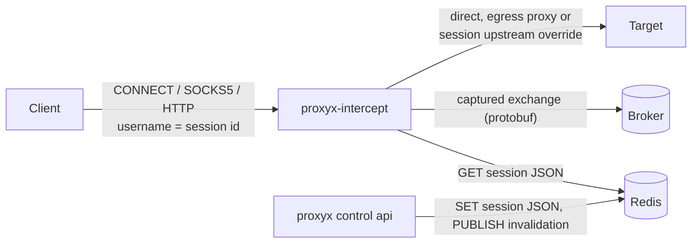
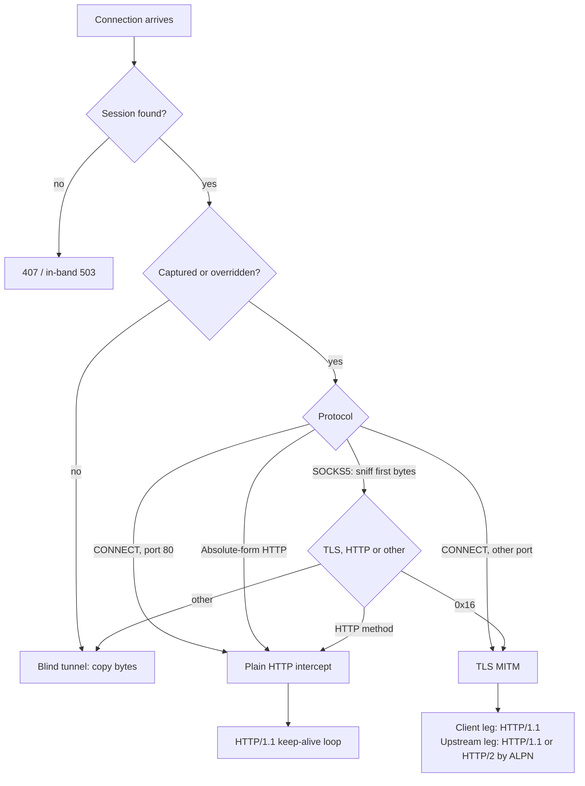

# Session proxy (`proxyx-intercept`)

The session proxy is the data plane for captured traffic. A client authenticates with a **session id**, and the proxy routes each connection according to the session's configuration: capture and intercept it, tunnel it blindly, send it to a private upstream, chain it through an egress proxy, rate-limit it per org. Every intercepted HTTP exchange and WebSocket message is published to a broker for the control plane to store (see [capture-pipeline.md](capture-pipeline.md)).

It ships as its own binary, `proxyx-intercept`, and not as a `proxyx` subcommand. Its upstream TLS stack (BoringSSL, chosen for browser-grade fingerprints) exports the same C symbols as the OpenSSL that the control plane's Kafka client links, and one process cannot hold both.

```
proxyx-intercept [--config <file>]
```

The pool gateway described in [gateway.md](gateway.md) is a different component: it leases pooled upstream IPs. The session proxy never selects a pool IP; it dials the target directly or through the single egress proxy configured on the session's org. For where both fit together see [architecture.md](architecture.md).



## Listeners

| Listener | Default address | Protocols | Enabled |
|---|---|---|---|
| CONNECT | none (`connect_addr` is required) | HTTP `CONNECT` tunnels and absolute-form HTTP requests | always |
| HTTP forward | none (`http_addr` is optional) | same handler as CONNECT | only when `http_addr` is set |
| SOCKS5 | `0.0.0.0:1080` (`socks_addr`) | SOCKS5 `CONNECT` with username/password auth | always |
| Admin | `0.0.0.0:8888` (`api_addr`) | `GET /health/live`, `GET /health/ready` (alias `GET /health`), `GET /metrics`, optional profiling routes | always |

The conventional ports are 8443 for CONNECT and 8080 for the HTTP forward listener (the container image exposes 8443, 1080 and 8888). Those values come from `Config::default()` in the code, but configuration loading does not use that `Default`: `connect_addr` has no serde default, so the process refuses to start without it, and `http_addr` is an `Option` that stays unset (listener off) unless you configure it. Set both explicitly:

```toml
# intercept.toml
connect_addr = "0.0.0.0:8443"
http_addr    = "0.0.0.0:8080"
```

The CONNECT and HTTP listeners run the same handler (`handle_client`); they differ only in port. Either port accepts `CONNECT host:port` tunnels and plain `GET http://host/path` forward requests.

Every accepted connection takes a slot from one shared pool of `tuning.max_connections` (default 10000). The accept loops never wait for a slot: when all are taken, the new connection is closed at once and counted in `proxyx_intercept_connection_limit_refusals_total`. The CONNECT and HTTP listeners first try to send `503` with `X-ProxyX-Error: connection_limit` and `Retry-After: 1`; the SOCKS5 listener just closes. Open connections are in `proxyx_intercept_connections_active`. Accepted client sockets get TCP keepalive and `TCP_NODELAY` (see [Network options](configuration.md#session-proxy-network-options)).

The admin listener answers `/health/live` and `/health/ready`; see [Health and readiness](#health-and-readiness). A listener that fails to bind logs an error and exits its task, the process keeps running, and `/health/ready` reports the `listeners` check failing.

## Session credential

The session id (a UUID created by the control plane, see [control-api.md](control-api.md)) is the proxy username. The password is ignored: it may be any string, including empty. A session URL has the form the control plane returns:

```
http://<session-uuid>:password@proxy.example.com:8443
socks5://<session-uuid>:password@proxy.example.com:1080
```

| Listener | How the id is read | Failure |
|---|---|---|
| CONNECT / HTTP | `Proxy-Authorization: Basic base64(<uuid>:<anything>)` | `407` with `Proxy-Authenticate: Basic realm="proxy"` for a missing or malformed header, bad UUID, unknown or expired session. `503` when the session backend is unavailable. |
| SOCKS5 | username of the RFC 1929 sub-negotiation (method `0x02` is required) | a malformed UUID receives RFC 1929 authentication failure (`0x01`); for a valid UUID, see [Errors](#errors): the handshake succeeds and any lookup or routing failure is reported in band |

### Sticky key

A client that runs many sessions of its own over one control-plane session can tell their captures apart by appending an opaque key of its own choosing to the username:

```
http://<session-uuid>-sid-<key>:password@proxy.example.com:8443
socks5://<session-uuid>-sid-<key>:password@proxy.example.com:1080
```

`<key>` is 1 to 64 characters of `[A-Za-z0-9_-]`. A username with a malformed key (empty, too long, another character) is rejected like a malformed UUID: `407` on the CONNECT and HTTP listener, authentication failure on SOCKS5. The key is a label only:

- The credential authenticates exactly as the bare session id does. The key selects no session, changes no routing, rate limit, capture rule or egress, and is never looked up or checked against anything. A client can invent any key without gaining anything, and a wrong key never turns an unknown session into a known one.
- The proxy copies the key onto each captured exchange of that connection as the capture-only request header `X-ProxyX-Sticky-Key`. It is not forwarded to the target. A header of that name that the client itself sends is dropped from the captured copy, so the value comes only from the credential. The ingester stores it as `correlation_id` when no [correlation header](capture-pipeline.md#ingester) of the exchange set one; see there for the rule.
- Because the client chooses it, the key is a correlation hint, not evidence of identity. Do not derive it from anything secret you would not put in a log; a hash of the client's own session id is a good choice.
- WebSocket messages carry no correlation column, so they are not tagged.

The proxy strips `Proxy-Authorization` and `Proxy-Connection` from every request it forwards and from every request it captures, so the session credential never reaches the origin or ClickHouse.

## Session lookup and caches

A session is a JSON `SessionConfig` stored by the control plane as a plain Redis string. The proxy reads it on the first request and caches it.

| Redis key or channel | Type | Written by | Purpose |
|---|---|---|---|
| `{prefix}:session:{session_id}:data` | string (JSON), `EX` = session TTL | control API | session configuration |
| `{prefix}:session_invalidations` | pub/sub channel, payload = session UUID | control API | drop a session from every proxy's local cache |
| `{prefix}:ratelimit:{org_id}` | hash `tokens`, `last_ms`, TTL 3600 s | proxy (Redis rate-limit backend) | token bucket state |
| `{prefix}:ratelimit:{org_id}:config` | hash `burst`, `rpm` | control API | per-org limits the Lua script reads |
| `<redis_key_prefix>:request_log` (`request_log.stream_name`) | stream | proxy, control API | capture log when `broker_kind = "redis_stream"` |

`{prefix}` is `redis_key_prefix` (default `proxyx`). It isolates deployments that share one Redis. The stream name is configured separately and is not prefixed.

Lookup order in `get_session`:

1. **Local cache** (moka, 100 000 entries, evicted after 3600 s without use). A hit whose `expires_at_ms` has passed is dropped and the lookup continues to Redis. A background task also evicts expired entries every 30 s.
2. **Negative cache** (50 000 entries, 5 s). A session id confirmed absent in Redis is answered `not found` without a Redis round trip for 5 s, which throttles floods of random ids.
3. **Redis `GET`**, bounded by 2 s, with one retry after a failed first attempt. A timeout or error becomes `backend unavailable` (HTTP `503`), not `not found`.

A payload that fails to parse, names an invalid upstream override, or is already expired is treated as not found. Valid sessions go into the local cache.

The control API publishes an invalidation only when the last reference of a session is released (see [control-api.md](control-api.md#session-lifecycle)). Extending a session rewrites the Redis key without publishing; the proxy picks up the new expiry when its cached copy expires and it re-reads Redis. Deleting a session does not remove the Redis key, which is left to expire at its TTL. An invalidation therefore forces a re-read, and the re-read still finds the key until the TTL passes.

## Routing decision

For each connection the proxy resolves the target `host:port` and builds a routing decision from the session:

| Field | Source | Effect |
|---|---|---|
| `mitm` / `log` | host patterns and upstream overrides | intercept TLS, capture exchanges |
| `inject_headers` | session, only if captured | appended to every forwarded request |
| `serialize` | session, only if captured | one exchange at a time per session |
| `egress_proxy` | org setting copied into the session | second-hop proxy for the upstream dial |
| `upstream_override` | session `upstream_overrides` | send this logical authority to a private plain-HTTP target |
| `rate_limit` | org setting copied into the session | limits used by the `limiter` backend |
| `tls_profile` | session `agent` | BoringSSL ClientHello profile |

### Capture patterns

A host is captured when all of these hold:

1. it matches an entry of the session's `captured_hosts`, and
2. it does not match an entry of the session's `excluded_hosts`, and
3. it does not match an entry of the proxy-wide `no_capture_hosts`.

Pattern syntax (`host_matches`) is exact and case-sensitive. The host is lower-cased on the way in, so write patterns in lower case.

| Pattern | Matches |
|---|---|
| `*` | every host |
| `*.example.com` | `example.com` and any subdomain at any depth, but not `notexample.com` |
| `example.com` | exactly `example.com` |

Ports are not part of the pattern. Non-captured CONNECT and SOCKS5 connections are tunneled blindly and nothing is logged. Non-captured absolute-form HTTP requests instead use a framed, sanitized single exchange and close the client connection. `no_capture_hosts` (a list in the file, or a comma-separated string in `PROXYX_INTERCEPT_NO_CAPTURE_HOSTS`) is an operator-level deny list that wins over any session, for example package registries you never want to record.

### Upstream overrides

`upstream_overrides` maps an exact logical authority to a private plain-HTTP destination, for targets that exist only inside your network:

```json
{ "upstream_overrides": { "app.example.test:443": "http://app.internal.svc:8000" } }
```

Validation (`parse_upstream_override`, enforced by the control API at session creation and again by the proxy when it loads the session):

- the key is `host:port` with an explicit non-zero port, a lower-case canonical host (IPv6 in brackets), no wildcard;
- the value starts with `http://` and carries only `host:port`: no credentials, path, query or fragment.

When a connection's `host:port` equals an override key (host compared case-insensitively):

- the connection is always intercepted, regardless of `captured_hosts` and `no_capture_hosts`;
- the proxy terminates the client's TLS itself (with a certificate for the logical host) and speaks plain HTTP to the override target, so the target must not require TLS;
- the egress proxy is bypassed;
- the logical `Host` is preserved in the forwarded request.

Plain forward-proxy requests (`GET http://logical-host/...`) on sessions that have overrides, and every non-intercepted HTTP forward request, are limited to one exchange per connection. The response carries `Connection: close`; pipelined requests are not sent to the first origin. Reconnect for another request so authentication, routing, and credential stripping run again. Requests not selected for capture are relayed without capture.

### Egress proxy chaining

The org's egress proxy (`socks5` or `http` CONNECT, with optional username and password) is copied into the session when the session is created. The proxy dials the target through it instead of connecting directly. The target hostname is sent to the egress proxy, which resolves it. Without an egress proxy the proxy resolves DNS itself (`network.dns_cache_ttl_secs`, default 60 s; 50 000 entries) and tries every returned address.

A dial makes up to `network.egress_retries` attempts (default 3), pausing `network.egress_backoffs_ms` between them (default 100 ms, then 200 ms; the last value repeats), all inside one overall connect timeout of `network.upstream_connect_timeout_ms` (default 10 s). The WebSocket-over-HTTP/2 fallback dial uses the same egress path, so the proxy's own address is not exposed on that path. Every dial is guarded by a per-upstream [circuit breaker](#upstream-circuit-breaker).

### Injected headers and serialization

`inject_headers` is a list of `[name, value]` pairs appended after the client's own headers on every forwarded request of a captured connection. A header the client already sent is not replaced; both appear. Injected headers are not part of the captured `request_headers`, which record what the client sent (minus the stripped proxy headers). The pairs apply to HTTP/1.1 and HTTP/2 upstreams.

With `serialize = true`, the proxy holds a per-session mutex for the duration of each request/response exchange and releases it while a keep-alive connection is idle. Exchanges of one session run one after another even across connections. WebSocket messages are not serialized.

## Upstream circuit breaker

A target that keeps refusing or ignoring connections would cost every request the connect timeout and the retries. Each dial is therefore guarded by a circuit breaker kept per target:

| `target_kind` | Key | Used when |
|---|---|---|
| `egress_proxy` | the egress proxy's `host:port` | the session has an egress proxy |
| `private_override` | the override's upstream `host:port` | the logical authority has an `upstream_overrides` entry |
| `origin` | the origin `host:port` | a direct dial |

A breaker is **closed** while dials go through. It **opens** after `breaker.consecutive_failures` failed dials in a row (default 5), or when at least `breaker.failure_rate_pct` percent (default 90) of the dials in the last `breaker.rate_window_ms` (default 60 s) failed and there were at least `breaker.rate_min_calls` of them (default 20). While open it refuses dials at once, with no connect attempt. After `breaker.open_duration_ms` (default 30 s) it turns **half-open**: up to `breaker.half_open_max_probes` dials (default 1) at a time go through as probes, and every other dial is still refused. `breaker.success_threshold` successful probes in a row (default 2) close it; one failed probe opens it again. Each trip without a close in between multiplies the open period by `breaker.open_backoff_factor` (default 2.0) up to `breaker.max_open_duration_ms` (default 300 s).

What counts as a failure: a connect error (refused, reset, unreachable), a handshake error or a protocol error with the egress proxy, and a connect timeout. These do **not** count:

- a name that does not resolve (`upstream_dns`): that says something about the name, not about a server, and a resolver outage would otherwise open a breaker per host;
- a refusal that the egress proxy itself answered (an HTTP status other than 200 to `CONNECT`, a SOCKS reply other than success, rejected credentials): the proxy is up, so the answer counts as a success for its breaker;
- a request the proxy could not even send (a host name over 255 bytes, for example);
- anything after the connection exists: `4xx` and `5xx` responses, a failed TLS handshake with the origin, a client that disconnects.

A refused dial is answered like this:

| Listener | Reply |
|---|---|
| CONNECT, HTTP | `503 Service Unavailable` with `X-ProxyX-Error: upstream_unavailable` and `Retry-After` (seconds until the next probe), before any `200 Connection Established` |
| SOCKS5 | the in-band report described under [Errors](#errors), cause `upstream_unavailable`, for plaintext and TLS clients alike |

The connection counts as `outcome="upstream_unavailable"` in `proxyx_intercept_connections_total`. The state of every kind is exported as `proxyx_intercept_upstream_breaker_state`, with `..._transitions_total` and `..._rejected_total`; see [metrics/session-proxy.md](metrics/session-proxy.md). A sudden `open` for `origin` means a target went away; for `egress_proxy`, that the org's egress proxy is down and every session using it fails fast.

The table of breakers holds at most `breaker.max_targets` targets (default 10000); a target idle for `breaker.idle_ttl_ms` (default 15 minutes) is forgotten and its breaker starts closed again. State is per process: each replica learns about a failing target on its own. `breaker.enabled = false` turns the breaker off; dials are then attempted every time.

## Interception



- **CONNECT.** After `200 Connection Established`, a captured tunnel to port 80 is treated as plaintext HTTP; every other port is assumed to be TLS. Bytes the client pipelined after the `CONNECT` headers (for example a TLS ClientHello) are preserved.
- **SOCKS5.** SOCKS carries no scheme, so for a captured target the proxy reads the first client bytes: `0x16` means TLS, an HTTP method (`GET `, `POST `, `PUT `, `PATCH `, `DELETE `, `HEAD `, `OPTIONS `, `TRACE `, `CONNECT `, `PRI `) means plaintext HTTP, anything else is copied blindly. Blind tunnels never wait for client bytes, so server-speaks-first protocols work.
- **TLS.** The client side is terminated with rustls using a certificate minted on demand for the SNI name (see [CA](#ca-and-client-trust)). The proxy then connects to the upstream with BoringSSL using the session's [TLS profile](#tls-profiles) and ALPN `h2, http/1.1`. Certificate chains and hostnames are verified by default using system roots. An optional `[tls] ca_bundle` PEM file adds trusted roots. The client leg is always HTTP/1.1; if the upstream selects `h2`, the proxy translates each request into an HTTP/2 stream and the response back to HTTP/1.1.
- **HTTP/1.1 loop.** Requests are parsed, rate limited, forwarded with streaming bodies (64 KiB chunks, `Content-Length` and chunked framing preserved) and captured. Only up to `tuning.max_body_capture` bytes of each body are kept in the capture; the rest is forwarded untouched. On an HTTP/2 upstream the request body is buffered in full before it is sent, up to 64 MiB (`MAX_BUFFERED_BODY`); a larger declared or streamed body is answered with `413 Content Too Large`. The HTTP/1.1 path streams and has no such limit.
- **WebSocket.** A `101` response to a request offering `Upgrade: websocket` hands the connection to the WebSocket proxy: frames are forwarded byte for byte while a parallel parser reassembles messages and inflates `permessage-deflate` payloads. Each logical message becomes a capture linked to the `101` row through `parent_event_id`. Over an HTTP/2 upstream the proxy uses RFC 8441 Extended CONNECT and falls back to a fresh HTTP/1.1 dial when the server does not advertise `SETTINGS_ENABLE_CONNECT_PROTOCOL`. PING and PONG are forwarded but not captured (the context flag that would capture them is hard-wired off); CLOSE is always captured. The captured payload per message is capped by `tuning.max_body_capture`.
- **Plain HTTP forward proxying** of a non-captured host sends only one framed request without proxy credentials. Both origin and client connections close after the response; subsequent requests require a fresh authenticated connection.

A captured connection waits for the next request up to 30 s of idleness, then closes. The proxy waits up to 30 s for upstream response headers and answers `504` if none arrive. Body reads give up after 30 s without new bytes.

Chunked bodies impose an 8 KiB limit on each chunk-size line (including extensions) and each trailer line, plus a 64 KiB aggregate trailer limit. Metadata reads have deadlines as well as body idle limits, on streaming HTTP/1.1 and buffered HTTP/1.1-to-HTTP/2 paths. Oversized or stalled framing is rejected and the connection closes.

Responses without `Content-Length` or chunked transfer framing are delimited by the upstream's EOF. The proxy advertises `Connection: close` and closes the client leg immediately after forwarding that body; it does not wait for the next-request idle timeout. HTTP/1.1-to-HTTP/2 translation preserves the client's `Host` authority, including explicit ports and bracketed IPv6 addresses, in `:authority`.

Compressed WebSocket frames and fragmented compressed messages must fit `tuning.max_ws_compressed_message_bytes` (default 16777216 bytes, 16 MiB). The proxy checks declared sizes before buffering payloads and closes with code `1009` when the bound is exceeded. This transport limit is separate from the captured-payload cap.

### Upstream TLS trust

```toml
[tls]
verify_upstream = true
# ca_bundle = "/etc/proxyx/testing-ca.pem"
insecure_upstream_hosts = []
```

Keep verification enabled in production. For authorized testing of hosts with self-signed certificates, prefer adding their CA bundle. A session may explicitly set `insecure_upstream_tls = true` to disable chain and hostname checks for its intercepted upstream TLS connections. The proxy-wide `insecure_upstream_hosts` list makes equivalent exceptions for exact hostnames, compared case-insensitively; it does not support wildcards. Setting `verify_upstream = false` disables upstream verification globally and is unsafe outside controlled testing. Exceptions preserve browser fingerprint profiles and also apply to WebSocket HTTP/1.1 fallback dials.

An upstream verification or handshake failure produces `502 Bad Gateway` with `X-ProxyX-Error: upstream_tls` inside the intercepted TLS connection. No exchange is captured. Non-intercepted TLS tunnels remain end-to-end: the client verifies the origin certificate.

## CA and client trust

Interception requires clients to trust the proxy's CA. The control plane returns the CA certificate (PEM) in `ca_cert_pem` of every session response and at `GET /rpc/certificate`. Install it in the trust store the client uses, or pass it directly: `curl --cacert ca.pem`.

The CA is configured in the `[ca]` table. Leaf certificates are ECDSA P-256, signed by the CA, valid from one hour in the past to 24 hours ahead, with the SNI host as common name and DNS subject alternative name (`localhost` when the client sends no SNI). Up to 10 000 leaf certificates are cached; when full, entries older than an hour are evicted, or the oldest half if none qualify.

| `ca.type` | Material | Format |
|---|---|---|
| `generate` (default, `data_dir = "data"`) | `ca.der` and `ca.key.der` in `data_dir`; created on first start if missing | DER; generated CA is ECDSA P-256, self-signed, 10-year validity, CN `ProxyX MITM CA` |
| `file` | `cert_path`, `key_path` | raw DER files (not PEM) |
| `env` | `PROXYX_INTERCEPT_CA_CERT`, `PROXYX_INTERCEPT_CA_KEY` | PEM (`-----BEGIN ...`) or base64 of the DER |

The key must be PKCS#8. Environment variables for `ca.type = env`:

```sh
export PROXYX_INTERCEPT_CA__TYPE=env
export PROXYX_INTERCEPT_CA_CERT="$(cat ca.pem)"
export PROXYX_INTERCEPT_CA_KEY="$(cat ca-key.pem)"   # PKCS#8 PEM
```

**The control plane and the proxy must use the same CA.** The control plane serves a PEM certificate and the proxy signs leaf certificates with its own `[ca]` key, so a client that takes the certificate from the session response only trusts the proxy's leaf certificates when both sides hold the same CA. In `generate` mode they do, provided both processes use the same `data_dir`: they share `ca.der` and `ca.key.der` there, and whichever process starts first creates them. Everywhere else (containers with separate filesystems, production), load one CA into both: mint it once, then give the control plane the certificate (`ca.type = file` or `env`) and the proxy certificate and key (`ca.type = file` with DER files, or `env`). For example:

```sh
openssl ecparam -name prime256v1 -genkey -noout | openssl pkcs8 -topk8 -nocrypt -out ca-key.pem
openssl req -x509 -new -key ca-key.pem -sha256 -days 3650 \
  -subj "/CN=ProxyX MITM CA" \
  -addext "basicConstraints=critical,CA:TRUE" \
  -addext "keyUsage=critical,keyCertSign,cRLSign,digitalSignature" \
  -addext "subjectKeyIdentifier=hash" -out ca.pem
openssl x509 -in ca.pem -outform DER -out ca.der          # proxy ca.type = file
openssl pkey -in ca-key.pem -outform DER -out ca.key.der  # proxy ca.type = file
```

On Unix, generated CA directories use mode `0700`, and private keys are created exclusively with mode `0600`. Existing private-key files must be owned by the process's effective UID, with no group or world permissions. Both the control plane and session proxy warn and refuse unsafe key files; correct ownership and run `chmod 600 ca.key.der` before restarting. Generated keys are not encrypted at rest, so protect the storage volume and backups.

## TLS profiles

The outbound handshake approximates a browser's TLS ClientHello so destination servers see a browser-like client rather than a default library. It is a TLS-only approximation, not an exact browser clone (see [Verified scope and limits](#verified-scope-and-limits)). One connector per profile is built at startup; the profile is chosen per session from the `agent` string given at session creation (`TlsProfile::for_agent`, case-insensitive):

| `agent` contains | Profile | Notes |
|---|---|---|
| nothing (no `agent`), empty, or no match | `Chrome133` | default |
| `chrome` or `chromium` | `Chrome133` | X25519MLKEM768 first, GREASE, extension order permuted per handshake, OCSP/SCT requests, ECH GREASE <!-- wire-compat: User-Agent token --> |
| `firefox`, version `Firefox/N` with N >= 128, or no parsable version | `Firefox135` | X25519MLKEM768 first, no GREASE, OCSP request, ECH GREASE |
| `firefox`, N < 128 | `Firefox120` | no post-quantum group, otherwise as `Firefox135` |
| `safari` (and not chrome) | `Safari18` | AES-256 first in the TLS 1.2 suite list, GREASE, no OCSP/SCT/ECH extensions |

Chrome is tested first, so a Chrome user agent that also mentions Safari or Firefox selects `Chrome133`. The version is read from the literal text `Firefox/N`; an agent such as `FIREFOX/100.0` matches Firefox but has no parsable version, so it selects `Firefox135`. All profiles require TLS 1.2 or newer (`supported_versions` offers 1.3 and 1.2 only) and advertise ALPN `h2, http/1.1`. The Firefox profiles omit the FFDHE groups because BoringSSL cannot express them.

### Verified scope and limits

The profiles were checked by capturing the real ClientHello the proxy sends to a local raw TLS listener and comparing normalized fields (GREASE values, random, session ID, key-share bytes and, for Chrome, extension order are excluded) against two kinds of reference captured on the same host: utls parrots `HelloChrome_133` and `HelloFirefox_120`, and installed Chrome 157, a Chrome-family build 156 and Firefox 159. Those installed browsers are newer than the pinned profiles, so only the fields the profiles pin are compared.

What the captures confirm:

- Each `agent` selection maps to the profile in the table; profiles differ from one another on the wire; all agents of one profile produce the same normalized hello.
- `Chrome133` matches `HelloChrome_133` on TLS 1.2 cipher suites and order, signature algorithms, supported groups (`X25519MLKEM768`, `x25519`, `secp256r1`, `secp384r1`, no `secp521r1`), key-share groups, GREASE, extension permutation and ALPN, and also sends `status_request`, `signed_certificate_timestamp` and `encrypted_client_hello` (GREASE).
- `Firefox120` matches `HelloFirefox_120` on TLS 1.2 suites, signature algorithms and groups apart from the omitted FFDHE groups; both Firefox profiles also send `status_request` and `encrypted_client_hello` (GREASE). `Firefox135`'s groups match Firefox 159.
- Extension order is permuted per handshake for `Chrome133` only.
- Upstream verification stays on for every profile; a bad chain or hostname gives `502` with `X-ProxyX-Error: upstream_tls`, and the documented insecure exceptions keep the same ClientHello. The WebSocket HTTP/1.1 fallback dial uses the same profile with ALPN `http/1.1` only.

Known differences from the reference browsers, which this version does not remove:

- BoringSSL's safe API offers no certificate compression, ALPS, delegated credentials or record-size-limit extensions, so the profiles never send them. The JA3/JA4 hashes therefore differ from real browsers and from the utls parrots.
- The TLS 1.3 suite order is fixed by BoringSSL (AES-128, AES-256, ChaCha20). Firefox sends AES-128, ChaCha20, AES-256. For `Safari18` only the TLS 1.2 list leads with AES-256.
- `Firefox135` is not pinned against a Firefox 135 capture. Firefox 159 additionally sends `signed_certificate_timestamp` and certificate compression, and sends fewer TLS 1.2 suites and signature algorithms than the profile (no ECDSA CBC suites, no SHA-1 schemes).
- `Safari18` has no external reference; only its documented markers (AES-256-first TLS 1.2 suites, GREASE, no post-quantum group) are asserted.
- HTTP/2 is not emulated. The upstream HTTP/2 connection is identical for every profile: empty client `SETTINGS`, no connection `WINDOW_UPDATE`, pseudo-header order `:method`, `:scheme`, `:authority`, `:path`. No browser HTTP/2 capture was taken, so the match of these values to any browser is neither claimed nor verified.

## Rate limiting

The limit is per org (not per session or per client) and is applied per exchange: one token for each HTTP request, and one token for each client-to-server WebSocket message (the `101` upgrade itself is not rate limited over HTTP/2, and server-to-client messages are never limited). Connections that are not intercepted are not limited.

Two backends implement the same trait. Choose with `ratelimit.backend`:

| Backend | How it enforces |
|---|---|
| `redis` (default) | Each proxy keeps a local bucket per org and refills it from a Redis Lua token bucket in batches of half the org's burst. A new local bucket starts empty and must earn its first tokens from Redis, so the fleet-wide limit does not scale with replica count. Burst and rpm come from `{prefix}:ratelimit:{org}:config` (written by the control API), falling back to `default_burst` and `default_rpm` when that key is absent. |
| `limiter` | Every exchange calls the limiter service at `limiter_addr` (`proxyx limiter`) against a per-org bucket sized from the session's `rate_limit` (or the defaults when the session has none). No local pre-grant, so the limit is exact across replicas. Bucket TTL is one hour idle. |

| Key (`ratelimit.*`) | Default | Meaning |
|---|---|---|
| `default_burst` | 1000 | bucket size when the org has no settings |
| `default_rpm` | 6000 | refill rate in requests per minute when the org has no settings |
| `refill_threshold_pct` | 0.25 | `redis` backend: refill from Redis when the local bucket falls below this share of its cap |
| `rate_limit_max_wait_ms` | 1000 | longest wait for a token before the request is rejected |
| `failopen_policy` | `{ type = "grant_tokens", value = 1000 }` | behaviour when the backend is unreachable; the alternative is `{ type = "deny" }` |
| `backend` | `redis` | `redis` or `limiter` |
| `limiter_addr` | `127.0.0.1:39091` | limiter service address |
| `limiter_connect_timeout_ms` | 1000 | `limiter` backend: connect budget of one limiter connection |
| `limiter_io_timeout_ms` | 1000 | `limiter` backend: budget of one request/response exchange |
| `limiter_keepalive_secs` | 30 | `limiter` backend: idle time before the first TCP keepalive probe; 0 turns keepalive off |
| `limiter_breaker_failures` | 5 | `limiter` backend: consecutive transport failures that open the client's own circuit breaker; 0 turns it off |
| `limiter_breaker_open_ms` | 2000 | `limiter` backend: how long that breaker stays open before one probe |

A burst of 0 for an org never grants tokens, so every request of that org times out and is rejected. A `0` rate-limit default in the control plane therefore does not mean unlimited at the proxy.

When no token arrives within `rate_limit_max_wait_ms`, an HTTP exchange is answered `429 Too Many Requests` with `X-Proxy-Error: rate limit exceeded` and `Connection: close`, and the connection closes after the response. There is no `Retry-After`. On a WebSocket the connection is shut down instead; no status is sent. The time spent waiting is recorded as the `ratelimit_wait` overhead phase.

Fail-open: with `grant_tokens`, an unreachable Redis or limiter lets traffic through; every failed backend call is counted in `proxyx_intercept_ratelimit_backend_errors_total{backend}` and every request admitted that way in `proxyx_intercept_ratelimit_failopen_total{backend}`. For the Redis backend this switches that org's local bucket to permanent fail-open on that proxy process (the `value` is accepted for compatibility but not metered) until the bucket is evicted after 30 minutes idle or the process restarts. With `deny`, the exchange is rejected with the same `429`.

## Errors

The proxy distinguishes its own errors from the origin's. Responses it generates say so in an HTML body (`This response was generated by the proxyx proxy, not by the destination server`) and carry `Server: proxyx-intercept`.

| Situation | Listener | Status | Header |
|---|---|---|---|
| missing/invalid credential, unknown or expired session | CONNECT, HTTP | `407` (`Proxy-Authenticate: Basic realm="proxy"`) | `X-Proxy-Error: proxy authentication required` |
| session backend unavailable | CONNECT, HTTP | `503` | `X-Proxy-Error: session backend unavailable` |
| upstream connect failed | CONNECT, HTTP | `502` | `X-Proxy-Error: upstream connect to host:port failed: ...` (`private upstream unavailable` for overrides) |
| upstream connect timed out (`network.upstream_connect_timeout_ms`, 10 s) | CONNECT, HTTP | `504` | `X-Proxy-Error: upstream connect to host:port timed out` |
| upstream circuit breaker open | CONNECT, HTTP | `503` | `X-ProxyX-Error: upstream_unavailable` and `Retry-After`; `X-Proxy-Error` says which kind (`private upstream temporarily unavailable`, `egress proxy temporarily unavailable`, or `upstream host:port temporarily unavailable`) |
| connection limit reached | CONNECT, HTTP | `503`, then close | `X-ProxyX-Error: connection_limit`, `Retry-After: 1` |
| rate limit exceeded | intercepted HTTP | `429` | `X-Proxy-Error: rate limit exceeded` |
| no upstream response headers within `network.upstream_response_header_timeout_ms` (30 s) | intercepted HTTP | `504` | `X-Proxy-Error: upstream did not send response headers in time` |
| WebSocket upgrade could not be captured | intercepted HTTP | `502` | `X-Proxy-Error: websocket upgrade could not be captured by the proxy` |

For a syntactically valid session UUID, the SOCKS5 listener answers CONNECT with success (`0x00`) before the upstream is checked, so a missing session or dial failure surfaces as the response to the client's first request. A malformed UUID instead receives RFC 1929 authentication failure before CONNECT. On a captured host the first client bytes pick the protocol (TLS, HTTP, or anything else, which is tunneled opaquely); a target that sends first (an SMTP, SSH or MySQL banner) is tunneled opaquely at once, without waiting for the client or for `network.socks_handshake_timeout_ms`. For in-band failures it reads the request (plaintext HTTP is answered directly; TLS is terminated with a fixed certificate for `proxyx-error.invalid` and then answered; anything else is closed), and replies with `X-ProxyX-Error` naming the cause:

| `X-ProxyX-Error` | Status | Meaning |
|---|---|---|
| `session_not_found` | 503 | unknown, expired or unusable session |
| `session_backend_unavailable` | 503 | Redis lookup failed or timed out |
| `upstream_refused` | 502 | connection refused by the target (direct dial only) |
| `upstream_dns` | 502 | name resolution failed (direct dial only) |
| `upstream_error` | 502 | any other dial failure; always used when an egress proxy is involved, because the refusal may be the egress proxy's |
| `upstream_timeout` | 504 | no connection within `network.upstream_connect_timeout_ms` (10 s) |
| `upstream_unavailable` | 503 | the target's circuit breaker is open; no dial was made (see [Upstream circuit breaker](#upstream-circuit-breaker)) |

The body is `ProxyX proxy error: <cause> <host>:<port>`, with `Cache-Control: no-store`. A client that trusts the proxy CA sees a clean response; a browser must ignore certificate errors for the fixed error certificate, which never matches the requested name. The proxy removes any `X-ProxyX-Error` header from upstream responses it forwards, so a target cannot imitate a proxy error.

Note the two spellings: the SOCKS5 in-band reports use `X-ProxyX-Error` with a machine-readable cause; most other proxy-generated responses use `X-Proxy-Error` with a human-readable message. The CONNECT and HTTP replies for an open circuit breaker (`upstream_unavailable`) and for the connection limit (`connection_limit`) carry both, so a client can match on the machine-readable cause.

## Capture buffering and backpressure

Captures travel through two bounded queues, and a slow broker pushes back all the way to the client connection:

1. a per-tunnel channel of `tuning.exchange_channel_capacity` (default 8) HTTP exchanges and another for WebSocket messages, drained by a task per tunnel;
2. the process-wide request-log writer queue of `request_log.channel_capacity` (default 256), drained by one task that publishes everything queued as a batch.

A full channel blocks the sender, which blocks the tunnel; there is no drop on overflow. Publishing retries failed records with exponential backoff (50 ms doubling to 5 s) up to five failed attempts per record; only a record that fails all attempts is dropped and counted in `proxyx_intercept_captures_dropped_total` (and logged at `error`); a capture sent after shutdown began, or one that cannot be encoded, is counted there too, so every accepted capture is either published or counted dropped. A publish call that takes more than 5 s logs `capture batch publish stalled`. Records are keyed by `source_id`, which keeps one source's captures in order. The full delivery model, the envelope and ClickHouse storage are in [capture-pipeline.md](capture-pipeline.md).

During a Redis outage (`broker_kind = "redis_stream"`) the writer holds the oldest record and retries it; the queue behind it fills and backpressures the tunnels. The head record is dropped (and counted) when it exhausts its five attempts, so a long outage loses the head records one at a time while the rest keep their place. Measured against a stopped Valkey: a 20 s outage dropped one capture and a 150 s outage dropped three. When Redis returns the connection manager reconnects within a few seconds (`redis` readiness and `capture_pipeline` recovered 1 to 4 s after the server came back in every run), the queue drains and traffic needs no restart. Delivery is at-least-once: an `XADD` that Redis applied but whose reply was lost (a stalled rather than refused connection) is sent again, so a stream can hold a duplicate with the same `event_id`, which the control plane's insert tolerates. Stream order across different client connections is arrival order at the writer, so captures that were blocked behind an outage can interleave out of request order; the `timestamp` of each capture is the request time and carries the true order.

During a RabbitMQ outage (`broker_kind = "rabbitmq"`) every publish fails at once: the producer reconnects with its own backoff (`rabbitmq.reconnect_initial_backoff_ms`, doubling up to `rabbitmq.reconnect_max_backoff_ms`), so a capture uses its five attempts in under a second and is dropped and counted, and `capture_pipeline` readiness turns `503` with the last error as detail. While it is failing the proxy asks the broker every `health.check_interval_ms` (reconnect, then a passive declare of each partition queue), so readiness returns without further traffic as soon as the producer has reconnected, and after a clean batch otherwise. Measured against a killed broker with a unique id in each request: a 20 s outage dropped the 123 captures proxied meanwhile, `captures_dropped_total` rose by exactly 123, the 71 others were in the queues and none of the 123 was, readiness was `503` for the whole outage and `200` again 10 s after the broker returned (the reconnect backoff), with no restart. A confirm that times out (a frozen broker) can still have been applied, so a dropped capture may also appear in the queue: delivery is at-least-once.

During a Kafka outage the client retries inside the publish call, so nothing is dropped: the batch waits, the queue fills and backpressures the tunnels, and readiness fails when nothing was published for `health.capture_publish_stale_ms` (60 s) or the queue stayed full for `health.capture_stall_window_ms` (30 s). The client's reconnect backoff is capped at 5 s, so publishing resumes within seconds of the broker accepting connections (measured 19 to 21 s after a killed single-node broker was started, which is its own start-up time); before the cap a broker that reset one connection while starting was not retried for 77 s. All 542 captures of an 80 s outage were published, none dropped.

Header values are cut at 512 bytes (`tuning.max_header_capture`, on a character boundary) in the capture, and bodies at `tuning.max_body_capture` (default 512 KiB). `request_body_size`, `response_body_size` and a WebSocket message's `payload_size` always hold the full size (decoded body, or decompressed message), whatever was kept, and `*_truncated` says whether the stored bytes are a prefix. Forwarded traffic is never truncated.

## Health and readiness

The admin listener has two probes:

| Route | Meaning |
|---|---|
| `GET /health/live` | `200` with `{"status":"live"}` while the process runs and the admin API answers. Use it as the liveness probe: it does not depend on Redis, the broker or the listeners. |
| `GET /health/ready` | `200` when the proxy should receive traffic, `503` otherwise. The body lists every check. Use it as the readiness probe. |
| `GET /health` | alias of `/health/ready`, for probes configured before the split |

```json
{"ready":false,"draining":false,"checks":{
  "capture_pipeline":{"ok":true},
  "listeners":{"ok":true},
  "redis":{"ok":false,"detail":"PING timed out after 1s (3 consecutive failures)"}}}
```

Readiness is the conjunction of these, all reported in the body and as `proxyx_intercept_readiness_check{check}` (1 passing, 0 failing); `proxyx_intercept_ready` is the overall result:

| Check | Fails when | Recovers when |
|---|---|---|
| `redis` | `health.redis_failure_threshold` (default 3) consecutive `PING`s through the shared Redis connection fail or take longer than `health.redis_timeout_ms` (1 s). The ping runs every `health.check_interval_ms` (2 s). | the next `PING` succeeds |
| `capture_pipeline` | the capture queue has stayed at or above `health.capture_stall_fraction` (0.9) of `request_log.channel_capacity` for longer than `health.capture_stall_window_ms` (30 s), **or** captures are queued or being published and nothing was published for `health.capture_publish_stale_ms` (60 s). **or** the writer dropped a capture after its fifth failed attempt and no batch has published cleanly since. The last rule catches a broker that fails at once (a refused connection, a nack) and never stalls the writer. A queue that only fills during a burst and drains does not fail it; an idle writer is healthy however long it has been idle. | the queue drops below the fraction and publishing makes progress; after dropped captures, the next batch publishes cleanly **or** the broker answers the probe the check runs every `health.check_interval_ms` while it is failing (RabbitMQ: reconnect and declare each partition queue passively; Kafka: topic metadata; Redis: `PING`), so a balancer that stopped sending traffic still sees it recover |
| `listeners` | a listener has not bound yet or its accept loop has exited, for example after a bind error | the listener is bound again (in practice a restart) |

Readiness is also `503` with `"draining":true` from the moment the proxy receives `SIGTERM` or Ctrl-C (`proxyx_intercept_draining` is 1). This happens first, before any listener closes, so a balancer sees the proxy go not-ready before connections are refused; `health.drain_notice_ms` (default 0) adds a pause between the two for balancers that need a few probe intervals.

A failing readiness check does not stop the proxy from serving the connections it already has, and it does not close the listeners. It only tells the orchestrator or balancer to stop sending new traffic. Point the liveness probe at `/health/live`, not `/health/ready`: otherwise a Redis or broker outage restarts every pod instead of pausing traffic to it.

## Admin endpoints and profiling

| Route | Description |
|---|---|
| `GET /health/live` | liveness, always `200` while the API answers |
| `GET /health/ready` | readiness, `200` or `503` with a JSON body; `GET /health` is an alias |
| `GET /metrics` | Prometheus text format; metric catalogue in [metrics/session-proxy.md](metrics/session-proxy.md) |
| `GET /debug/stalls` | only with profiling on: JSON of recent runtime stalls |
| `GET /debug/pprof/profile?seconds=N` | only with profiling on: CPU profile (pprof protobuf, 99 Hz), `N` in 1..=3600, default 30 |

Profiling is opt-in through the environment variable `PROXYX_INTERCEPT_PROFILING=1` (or `true`). It is read directly from the environment and is not a configuration key. With it off the two routes return `404`.

The stall probe ticks every 10 ms on the Tokio runtime and records an event when a tick fires more than 50 ms late (up to 2000 events are kept). Each event has `at_unix_ms`, `lag_ms`, `threads` (thread states after the pause) and `before` (thread names, kernel states, wait channels and syscalls sampled during the pause from `/proc/self/task`). `/debug/stalls` returns `{ "threshold_ms": 50, "interval_ms": 10, "events": [...] }`. The probe also feeds `proxyx_intercept_scheduler_lag_seconds`. Only one CPU profile runs at a time: a second request gets `409`, and `seconds` out of range gets `400`.

```sh
curl -s localhost:8888/debug/stalls | jq '.events[0]'
curl -s -o cpu.pb 'localhost:8888/debug/pprof/profile?seconds=30' && go tool pprof cpu.pb
```

The admin routes are unauthenticated; keep the port off public networks.

## Graceful shutdown

On `SIGTERM` or Ctrl-C the proxy:

1. starts reporting not ready: `/health/ready` answers `503` with `"draining":true` and `proxyx_intercept_draining` becomes 1 (after `health.drain_notice_ms`, default 0, it goes on to step 2);
2. cancels the listeners (they stop accepting immediately); the admin server keeps running;
3. waits for in-flight tunnels: every 2 s it checks how many connection slots are still held, up to `tuning.shutdown_drain_timeout_secs` (default 300), then abandons the rest;
4. closes the capture writer and drains the buffered captures within 30 s total: half of the budget for the queue to empty, the remainder for the broker producer to flush;
5. stops the admin server.

`/health/live`, `/health/ready` and `/metrics` therefore answer for the whole drain.

Set the orchestrator's termination grace period above the drain timeout plus the 30 s flush, minus any `preStop` delay. Release builds abort on panic; the panic is logged once as an `error` line first.

## Limits and timeouts

| Item | Value |
|---|---|
| Concurrent connections | `tuning.max_connections` = 10000 |
| Request head (CONNECT/HTTP listener) | 128 KiB, 256 headers, read within `network.client_header_timeout_ms` = 5 s |
| SOCKS5 handshake | `network.socks_handshake_timeout_ms` = 5 s |
| Upstream connect | `network.upstream_connect_timeout_ms` = 10 s (all retries together) |
| TLS handshake (client or upstream) | `network.tls_handshake_timeout_ms` = 10 s each |
| Keep-alive idle | `network.http_keepalive_idle_timeout_ms` = 30 s |
| Requests per client connection | `network.http_keepalive_max_requests` = 0 (no limit) |
| Upstream response headers | `network.upstream_response_header_timeout_ms` = 30 s, then `504` |
| Body idle | `network.body_idle_timeout_ms` = 30 s without a byte |
| HTTP/2 SETTINGS ping before a WebSocket upgrade | `network.h2_settings_timeout_ms` = 2 s |
| TCP keepalive | on, 60 s idle, 20 s interval, 3 probes, on client and upstream sockets |
| Captured body per exchange | `tuning.max_body_capture` = 512 KiB |
| Captured header value | `tuning.max_header_capture` = 512 bytes |
| Captured WebSocket payload per message | same as the body cap |
| Session cache / negative cache | 100 000 entries, 3600 s idle / 50 000 entries, 5 s |
| Session Redis lookup | 2 s, one retry |
| Leaf certificate cache | 10 000 |
| DNS cache | 50 000 entries, `network.dns_cache_ttl_secs` = 60 s |
| Upstream breaker table | `breaker.max_targets` = 10000 targets, 15 min idle |

## Configuration reference

Sources, lowest priority first: `./intercept.toml` (or `/etc/proxyx/intercept.toml` when the local file is absent), environment variables `PROXYX_INTERCEPT_<KEY>` (`__` nests: `PROXYX_INTERCEPT_TUNING__MAX_CONNECTIONS`), and the `--config` file, which overrides both. See [configuration.md](configuration.md) for the shared loader.

| Key | Default | Notes |
|---|---|---|
| `id` | random UUID per start | becomes `proxy_id` on every capture; `PROXYX_INTERCEPT_ID` |
| `connect_addr` | **required** | CONNECT listener |
| `http_addr` | unset (listener off) | HTTP forward listener |
| `socks_addr` | `0.0.0.0:1080` | SOCKS5 listener |
| `api_addr` | `0.0.0.0:8888` | admin listener |
| `redis_url` | `redis://127.0.0.1:6379` | `rediss://`, and `redis+sentinel://` / `rediss+sentinel://` (`:pw@h1:26379,h2:26379/<master>`) are accepted; fatal at startup if unreachable |
| `redis_key_prefix` | `proxyx` | must equal the control plane's value |
| `no_capture_hosts` | empty | list or comma-separated string |
| `broker_kind` | `redis_stream` | `redis_stream`, `kafka` or `rabbitmq` (`redpanda` is a deprecated alias of `kafka`); must match the control plane |
| `request_log.stream_name` | `<redis_key_prefix>:request_log` | Redis stream; must equal the control plane's `request_log_stream` |
| `request_log.channel_capacity` | 256 | writer queue and batch size; must be greater than 0 |
| `request_log.max_stream_len` | 1000000 | `XADD MAXLEN ~ N`; 0 disables trimming |
| `kafka.*` | none | required when `broker_kind = "kafka"`; see [capture-pipeline.md](capture-pipeline.md#broker) |
| `rabbitmq.*` | none | required when `broker_kind = "rabbitmq"`; see [capture-pipeline.md](capture-pipeline.md#rabbitmq-rabbitmq) |
| `ratelimit.*` | see [Rate limiting](#rate-limiting) | |
| `ca.*` | `type = "generate"`, `data_dir = "data"` | see [CA](#ca-and-client-trust) |
| `tuning.max_body_capture` | 524288 | bytes |
| `tuning.max_header_capture` | 512 | bytes per header value |
| `tuning.exchange_channel_capacity` | 8 | per-tunnel capture channel; must be greater than 0 |
| `tuning.max_connections` | 10000 | must be greater than 0 |
| `tuning.shutdown_drain_timeout_secs` | 300 | |
| `network.*` | see [configuration.md](configuration.md#session-proxy-network-options) | timeouts, HTTP keep-alive, DNS cache, egress retries, TCP keepalive |
| `breaker.*` | see [Upstream circuit breaker](#upstream-circuit-breaker) and [configuration.md](configuration.md#session-proxy-network-options) | per-upstream circuit breaker; `breaker.enabled = false` turns it off |
| `health.*` | see [Health and readiness](#health-and-readiness) and [configuration.md](configuration.md#session-proxy-network-options) | readiness checks and drain notice |
| `sentry.dsn`, `sentry.environment`, `sentry.release`, `sentry.sample_rate`, `sentry.traces_sample_rate` | unset / 1.0 / 0.0 | error reporting is off without a DSN |

Logging uses `RUST_LOG` (default `info`); `PROXYX_LOG_JSON=1` switches to JSON lines; `OTEL_ENABLED=true` turns on OTLP traces.

## Using a session

```sh
# Create a session (see control-api.md), then:
SESSION=0f6d3a4e-...        # session_id from the response
curl --cacert ca.pem -x "http://$SESSION:x@proxy.example.com:8443" https://example.com/
curl --cacert ca.pem --proxy "socks5h://$SESSION:x@proxy.example.com:1080" https://example.com/

# Why did it fail?
curl -si -x "http://$SESSION:x@proxy.example.com:8443" https://unreachable.invalid/ | head -20
```

`socks5h://` makes curl send the hostname to the proxy, which is what the routing patterns match on. With `socks5://` curl resolves the name itself and the proxy sees an IP address, which only matches `*` or an IP pattern.
